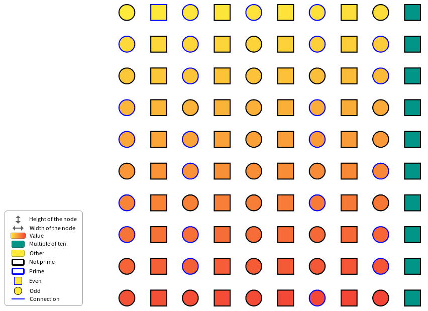
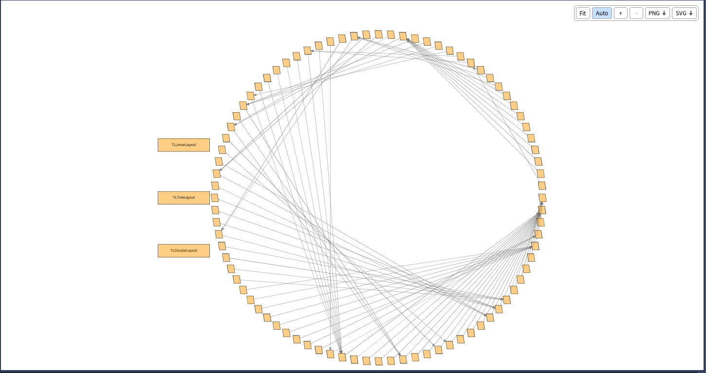
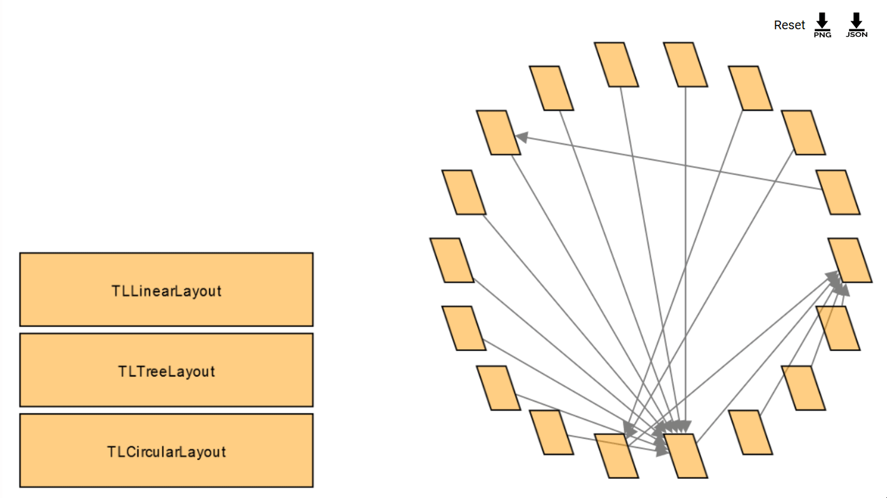

# Telescope

Telescope is an engine for efficiently creating meaningful visualizations. The purpose is to help the user concentrate on the problem at hand rather than understanding the nitty-gritty of a drawing library. It does so by exposing to the user to a few concepts of the domain of visualization: nodes and their contents, layouts, interactions, and update mechanism. For example, the user does not have to worry about the creation of composite or simple nodes, the engine handles it. 

The user can create a model of visualization and then render it via a connector to a visualization framework.

**Note: Telescope is not usable by itself. It needs to come with at least one connector. You can find the list of connectors [later in this document](#connectors).**

# Documentation

## API documentation

The API of Telescope is documented in [resources/doc](resources/doc/README.md), with screenshots and the list of the features: nodes and entities, groups and layouts, styling, connections, composite nodes, interactions, legends, visualization templates, requests and updates, and how to write a connector.

[](resources/doc/README.md)

## Version management 

This project use semantic versionning to define the releases. This mean that each stable release of the project will get associate a version number of the form `vX.Y.Z`. 

- **X** define the major version number
- **Y** define the minor version number 
- **Z** define the patch version number

When a release contains only bug fixes, the patch number increase. When the release contains new features backward compatibles, the minor version increase. When the release contains breaking changes, the major version increase. 

Thus, it should be safe to depend on a fixed major version and moving minor version of this project.

## Install Telescope

To install Telescope on your Pharo image you can just execute the following script:

```Smalltalk
    Metacello new
    	githubUser: 'TelescopeSt' project: 'Telescope' commitish: 'v2.x.x' path: 'src';
    	baseline: 'Telescope';
    	onWarningLog;
		onUpgrade: [ :e | e useIncoming ];
    	load
```

To add Telescope to your baseline just add this:

```Smalltalk
    spec
    	baseline: 'Telescope'
    	with: [ spec repository: 'github://TelescopeSt/Telescope:v2.x.x/src' ]
```

Note that you can replace the v2.x.x tag by a branch as #master or #development or a tag as #v1.0.0, #v1.? or #v1.0.x or a commit SHA.

## Connectors

As explained previously, Telescope works with connector to render visualizations. We will list here the official Telescope's connectors.

### Bloc

The Bloc connector of Telescope renders the visualizations in a window of Pharo, with [Bloc](https://github.com/pharo-graphics/Bloc), the graphical framework of Pharo. It is available at: [https://github.com/TelescopeSt/TelescopeBloc](https://github.com/TelescopeSt/TelescopeBloc)

```Smalltalk
Metacello new
	githubUser: 'TelescopeSt' project: 'TelescopeBloc' commitish: 'development' path: 'src';
	baseline: 'TelescopeBloc';
	load
```

It supports the features described in the [API documentation](resources/doc/README.md): all the styles of the nodes and of the connections, groups and composite nodes, the layouts (the nodes move smoothly when a layout is applied again), the interactions (mouse over, click, menus, pop ups, drag and drop, shape triggers...), and the legends. The user can zoom, pan and drag the nodes, and a toolbar fits the visualization in the window and exports it as a PNG or a SVG. The connector also has a browser of the demos of Telescope (`TLBlocDemoPresenter open`). Its CI runs on Pharo 14 and Pharo 15.



*Changing the layout of a group with a click: the nodes slide to their new places.*

### CytoscapeJs

The CytoscapeJs connector of Telescope is available at: [https://github.com/TelescopeSt/TelescopeCytoscape](https://github.com/TelescopeSt/TelescopeCytoscape)

This connector works with Seaside in order to render web visualizations.



### Roassal

A Roassal connector was initialized but we did not get the manpower to maintain it. 

If someone wants to revive this connector, the last version we got was in this commit: [9fafc43ade53f8d16e40c82dffbccd2371f3851d](https://github.com/TelescopeSt/Telescope/commit/9fafc43ade53f8d16e40c82dffbccd2371f3851d)

## Examples

The demos of Telescope are in the class `TLDemos` (package `Telescope-Demo`), and the Bloc connector has a browser which lists them and shows their code. More examples can be found in the CytoscapeJs connector repository.

## Smalltalk versions compatibility

| Telescope version 	| Compatible Pharo versions 	|
|-------------------	|---------------------------	|
| v1.x.x	   		   	| Pharo 61, 70                 	|
| v2.x.x	   		   	| Pharo 61 - 14         	|
| development      		| Pharo 61 - 14         	|

## Contact

If you have any question or problem do not hesitate to open an issue or contact cyril (a) ferlicot.fr