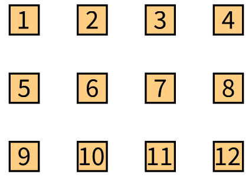
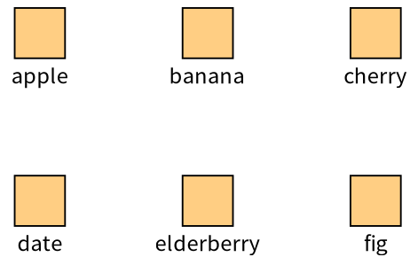
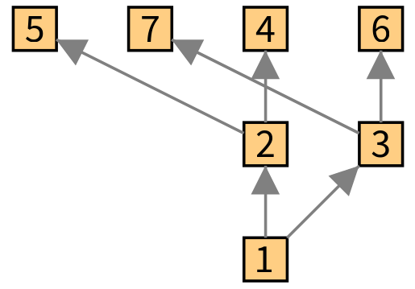
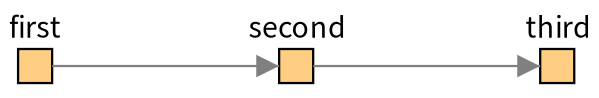

# 1. Getting started

> [!NOTE]  
> All the examples in this documentation are rendered via Telescope-Bloc connector. 

## The model

A visualization is a tree of *drawables*:

```
TLDrawable
├── TLConnectable
│   ├── TLEntitiesGroup               a group of drawables, placed by a layout
│   │   └── TLVisualization           the root group: it can be opened
│   └── TLAbstractNode                a node, for one entity
│       ├── TLSimpleNode              a leaf
│       └── TLCompositeNode           a node which contains a group of nodes
├── TLConnection                      a link between two nodes
├── TLLegend                          the legend of the visualization
└── TLShapeTrigger                    a small shape which runs an action when it is clicked
```

You build a visualization by sending messages to a `TLVisualization`: you add nodes for the entities of your model, you connect them, you give them a style and a layout, and you add interactions. Nothing is drawn until the visualization is opened with a connector, and Telescope never draws anything itself: it only describes.

## A first visualization

```smalltalk
| visualization |
visualization := TLVisualization new.
visualization addNodesFromEntities: (1 to: 12).
visualization nodeLabel: #asString.
visualization layout: (TLLinearLayout gap: 20 perLine: 4).
visualization open.
```



- `TLVisualization new` is an empty visualization.
- `addNodesFromEntities:` adds one node for each entity of the collection. The entities can be any objects.
- `nodeLabel: #asString` says that the label of a node is the result of `asString` on its entity. The argument is a symbol, or a block with the entity as parameter.
- `layout:` says how the nodes are placed. Here they are in lines of four nodes with 20 pixels between them.
- `open` displays the visualization in a window of the connector.

`TLVisualization fromEntities:` creates the visualization and the nodes in one message, which makes the example shorter:

```smalltalk
| visualization |
visualization := TLVisualization fromEntities: #(#apple #banana #cherry #date #elderberry #fig).
visualization styleSheet
	nodeLabel: #asString position: #bottom;
	width: 30;
	height: 30.
visualization layout: (TLLinearLayout gap: 70 perLine: 3).
visualization open.
```



## Connecting nodes

`connectFollowingProperty:` connects each node to the nodes of the entities which a block (or a symbol) answers for its entity:

```smalltalk
| visualization |
visualization := TLVisualization fromEntities: (1 to: 7).
visualization nodeLabel: #asString.
visualization connectFollowingProperty: [ :number | { number * 2. number * 2 + 1 } select: [ :candidate | candidate <= 7 ] ].
visualization layout: TLTreeLayout new.
visualization open.
```



You can also connect two nodes by hand with `connectTo:`, which answers the connection:

```smalltalk
| visualization first second third |
visualization := TLVisualization new.
visualization styleSheet nodeLabel: #asString position: #top.
first := visualization addNodeFromEntity: 'first'.
second := visualization addNodeFromEntity: 'second'.
third := visualization addNodeFromEntity: 'third'.
first connectTo: second.
second connectTo: third.
visualization layout: (TLLinearLayout gap: 100).
visualization open.
```



Chapter 5 describes the connections.

## Opening a visualization

| Message | What it does |
|---|---|
| `visualization open` | Opens the visualization in a window of the current connector |
| `visualization close` | Closes it |
| `visualization title: 'My title'` | The title of the window. The default is `Telescope  Visualization` (a template defines its own) |
| `visualization openingDimension: 800 @ 600` | The size of the window, `720 @ 480` by default |
| `visualization generator: aConnector` | The connector which renders this visualization |

Telescope does not render by itself: the visualization needs a connector (see chapter 11). A visualization uses the connector `TLCurrentConnector value` answers, which is the connector with the highest priority among the ones which are loaded. To use another one for a moment:

```smalltalk
TLCurrentConnector value: MyConnector during: [ visualization open ].
```

If no connector is loaded, `open` shows a message which says so.

## The demos

The class `TLDemos` has a demo for most of the features of this documentation, in the class-side methods whose name starts with `example`. Each one answers a visualization:

```smalltalk
TLDemos exampleSimpleConnections open.
```

The demos of the Bloc connector have a browser which lists them with readable names, filters them by theme (style, layout, interaction, composite...) and shows the code of each demo next to the result: in the world menu, `Telescope > Telescope bloc demo browser`, or `TLBlocDemoPresenter open`.

## What next

- To create, find and change nodes: [chapter 2](02-Nodes-and-Entities.md).
- To place them: [chapter 3](03-Groups-and-Layouts.md).
- To change how they look: [chapter 4](04-Styling.md).
