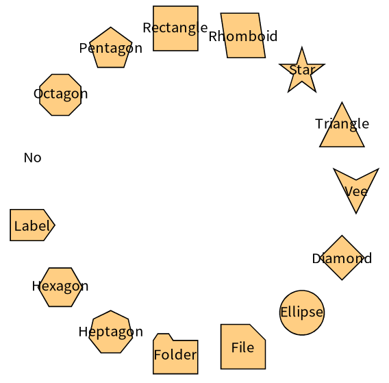
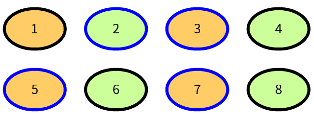
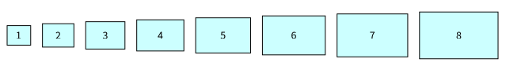
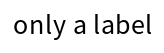

# 2. Nodes and entities

A *node* is the representation of one *entity* of your model. Telescope never copies the entity: the node keeps a reference, and the style, the label and the interactions are computed from it.

## Creating nodes

| Message | What it does |
|---|---|
| `addNodeFromEntity: anEntity` | Adds a node for the entity and answers it |
| `addNodesFromEntities: aCollection` | Adds a node for each entity and answers the nodes |
| `addNodeIfNotPresentFromEntity: anEntity` | Adds the node only when the group has no node for the entity |
| `addAbsentNodesInVisualizationFromEntities: aCollection` | Adds the nodes for the entities which have none yet |
| `addCompositeNodeFromEntity: anEntity children: aCollection` | Adds a node which contains one node for each entity of the collection (chapter 6) |
| `TLVisualization fromEntities: aCollection` | Creates a visualization with the nodes |

These messages are understood by every group, a visualization being a group (chapter 3). The nodes are added to the group which receives the message.

```smalltalk
visualization := TLVisualization new.
first := visualization addNodeFromEntity: 'first'.
visualization addNodesFromEntities: #('second' 'third').
```

### The node creation strategy

How a node is created from an entity is decided by the *node creation strategy* of the group (`group nodeCreationStrategy`). By default it creates a simple node. When you tell the group that the entities have children, it creates composite nodes:

```smalltalk
visualization childrenProperty: #children.
```

Chapter 6 shows how to create composite nodes and how to sort their children.

## Finding nodes

| Message | Answers |
|---|---|
| `group nodeForEntity: anEntity` | The node of the entity. It signals `NotFound` when there is none |
| `group nodeForEntity: anEntity ifAbsent: aBlock` | The node of the entity, or the value of the block |
| `group nodesForEntities: aCollection` | The nodes of the entities |
| `group nodes` | The nodes of the group, which are its direct children |
| `group allNodes` | The nodes of the group and of its sub groups |
| `group allNodesRecursively` | The same, and the children of the composite nodes |
| `group allConnections` | The connections of the nodes of the group |
| `group subGroups` | The groups inside of the group |
| `group size`, `isEmpty`, `includes:` | As for a collection |

A group is also a collection of its drawables: `do:`, `select:`, `collect:`, `nodesDo:`, `nodesCollect:` and the other enumerating messages work, and `obtain` starts the requests of chapter 10.

The entities are compared with `=`: two entities which are equal have the same node.

## The API of a node

A node knows its entity, its connections and its place in the visualization:

| Message | Answers |
|---|---|
| `node entity` | The entity |
| `node entity: anotherEntity` | Changes the entity. The label is computed again at the next update |
| `node label` | The label which the style gives |
| `node outgoingConnections`, `incomingConnections`, `allConnections` | The connections of the node |
| `node outgoingAdjacentNodes`, `incomingAdjacentNodes`, `adjacentNodes` | The nodes at the other end of these connections |
| `node parent` | The group which contains the node |
| `node parentNode` | The composite node which contains it, if any |
| `node isLeaf`, `isComposite`, `isSimpleNode`, `isNode`, `isConnection`, `isGroup` | Tests on the kind of drawable |
| `node hasEntity` | Whether the node has an entity |

The messages which change a node:

| Message | What it does |
|---|---|
| `node hide` / `node show` | Hides the node, and the connections which join it, or shows them again |
| `node remove` | Removes the node from its group, with its connections |
| `node moveToGroup: aGroup` | Moves the node to another group. The layouts of both groups are applied again |
| `node connectTo: anotherNode` | Connects the nodes and answers the connection (chapter 5) |
| `node addInteraction: anInteraction` | Gives the node an interaction (chapter 7) |
| `node styleSheet` | The style of this node alone (chapter 4) |
| `node addStyle: #name` | Applies a named style to the node (chapter 4) |
| `node state` | A dictionary where actions and your code can keep information about the node |

## What a node looks like

By default, a node is a small orange square with its label inside it. Its shape, colors, border, size and label are properties of its style sheet, which can depend on its entity. Chapter 4 describes all of them. A few examples:







## Nodes with a label only

A node can have a shape and no label, a label and no shape, or both:

```smalltalk
| visualization |
visualization := TLVisualization fromEntities: (1 to: 6).
visualization styleSheet
	noNodeLabel;
	shape: TLNoShape.
(visualization nodeForEntity: 3) styleSheet
	nodeLabel: 'only a label'
	position: #inside.
visualization layout: (TLLinearLayout gap: 40).
visualization open.
```


