# 3. Groups and layouts

## Groups

A *group* is a set of drawables, placed together by one layout. A visualization is the root group. `visualization > #name` answers the sub group of that name, and creates it the first time:

```smalltalk
| visualization |
visualization := TLVisualization new.
visualization nodeLabel: #asString.
(visualization > #numbers)
	addNodesFromEntities: (1 to: 9);
	layout: (TLLinearLayout gap: 12 perLine: 3).
(visualization > #letters)
	addNodesFromEntities: ($a to: $i);
	layout: TLCircularLayout.
(visualization > #numbers) styleSheet backgroundColor: Color lightBlue.
(visualization > #letters) styleSheet
	backgroundColor: Color lightGreen;
	shape: TLDiamond;
	width: 30;
	height: 30.
visualization layout: (TLLinearLayout gap: 80).
visualization open.
```

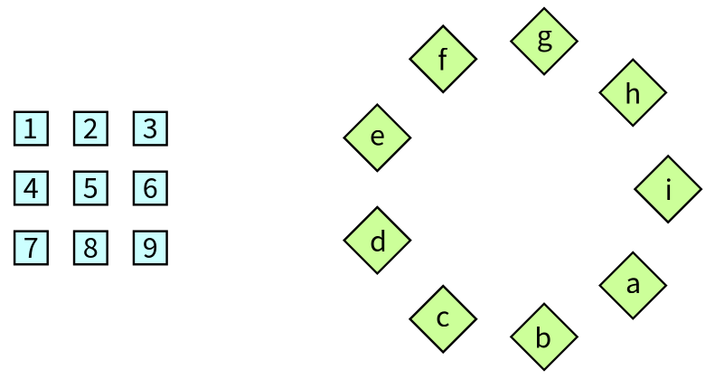

The nodes of a group are placed by the layout of the group (`#numbers` has a linear layout, `#letters` a circular one) and the groups are placed by the layout of their parent, which treats each group as one big node. A group can have its own style (here a different background and shape), its own interactions and its own node creation strategy. Groups can contain groups.

| Message | What it does |
|---|---|
| `group > #name` | The sub group of that name, created if necessary |
| `group subGroups` | The groups inside of the group |
| `group layout` / `layout:` | The layout of the group |
| `group styleSheet` | The style of the group, which its nodes inherit (chapter 4) |
| `node moveToGroup: aGroup` | Moves a node (or a group) to another group. Both groups are placed again |
| `group removeAll`, `group remove: aDrawable`, `group removeEntity: anEntity` | Remove drawables from the group |
| `group moveToFirstPosition: aNode` | Makes the node the first one of the group, which the layouts use as the first place |

Connections can join nodes of different groups: use the other group as the *context* of the connection (chapter 5).

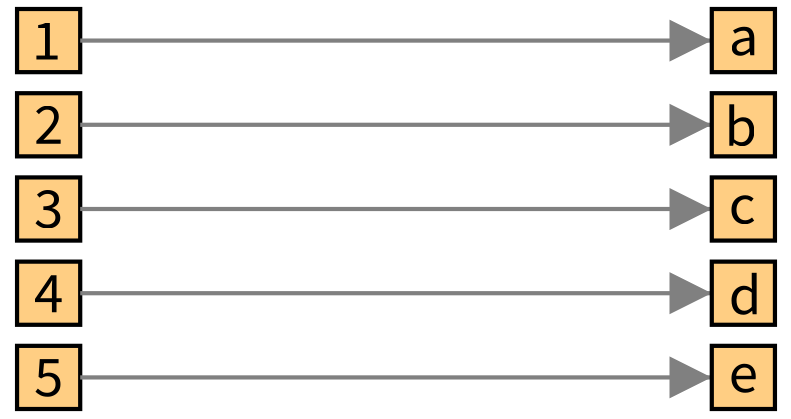

When a node is moved to another group at run time, for example by a click, the nodes of both groups are placed again. The `TLMoveConnectableAction` (chapter 7) does it.

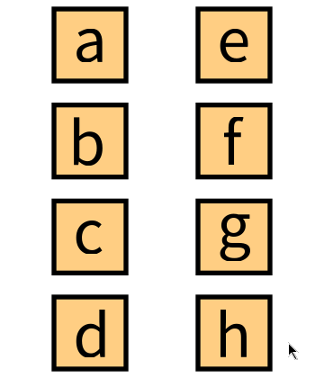

## Layouts

A layout places the nodes of a group. Give one to a group with `layout:`:

```smalltalk
visualization layout: (TLLinearLayout gap: 15 perLine: 5).
```

`TLLayout` is the superclass of all the layouts: `TLLinearLayout`, `TLCircularLayout` and `TLTreeLayout`, with `TLCircularTreeLayout` a variation of the last one.

### Linear layout

`TLLinearLayout` places the nodes in lines, in the order of the group, with a gap between them. What changes is when it starts a new line:

| Creation message | The line is full |
|---|---|
| `TLLinearLayout gap: 25` | Never: one line |
| `TLLinearLayout gap: 15 perLine: 5` | After 5 nodes |
| `TLLinearLayout gap: 15 maximumDimension: 200` | When the line would be longer than 200 pixels |
| `TLLinearLayout gap: 15 ratio: 16 / 9` | The layout tries to make the whole as wide as high as the ratio |
| `TLLinearLayout perLine: 5`, `maximumDimension:`, `ratio:` | The same, with the default gap |

The horizontal and vertical gaps can differ: `(TLLinearLayout perLine: 3) horizontalGap: 100; verticalGap: 20; yourself`. `maxElementsPerLine:`, `maximumDimension:` and `ratio:` also change the rule of an existing layout.

```smalltalk
| visualization |
visualization := TLVisualization fromEntities: (1 to: 12).
visualization nodeLabel: #asString.
visualization layout: (TLLinearLayout gap: 25).
visualization open.
```

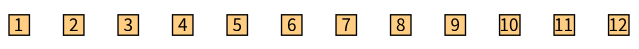

```smalltalk
| visualization |
visualization := TLVisualization fromEntities: (1 to: 14).
visualization nodeLabel: #asString.
visualization layout: (TLLinearLayout gap: 15 perLine: 5).
visualization open.
```

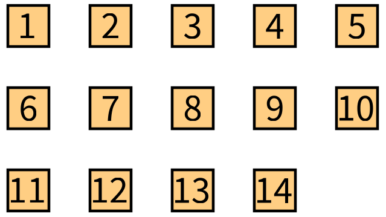

```smalltalk
| visualization |
visualization := TLVisualization fromEntities: (1 to: 14).
visualization nodeLabel: #asString.
visualization layout: (TLLinearLayout gap: 15 maximumDimension: 200).
visualization open.
```

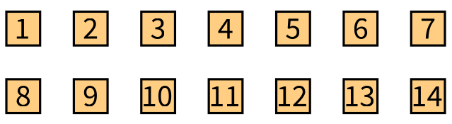

```smalltalk
| visualization |
visualization := TLVisualization fromEntities: (1 to: 30).
visualization nodeLabel: #asString.
visualization layout: (TLLinearLayout gap: 15 ratio: 16 / 9).
visualization open.
```

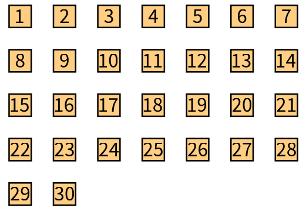

The direction of a layout is its angle, in degrees, counter clockwise: 0 places the lines from left to right, 90 from top to bottom, 180 from right to left and 270 from bottom to top. The class-side messages `leftToRight`, `topToBottom`, `rightToLeft`, `bottomToTop` and `angle:` create a layout with a direction, and `angle:` changes it. Any angle is valid:

```smalltalk
| visualization |
visualization := TLVisualization new.
visualization nodeLabel: #asString.
(visualization > #leftToRight) layout: TLLinearLayout leftToRight; addNodesFromEntities: (1 to: 4).
(visualization > #topToBottom) layout: TLLinearLayout topToBottom; addNodesFromEntities: (5 to: 8).
(visualization > #rightToLeft) layout: TLLinearLayout rightToLeft; addNodesFromEntities: (9 to: 12).
visualization layout: (TLLinearLayout gap: 60).
visualization styleSheet backgroundColor: Color white.
visualization open.
```

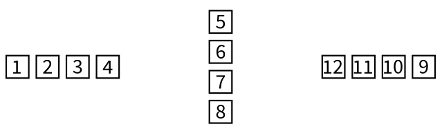

```smalltalk
| visualization |
visualization := TLVisualization fromEntities: (0 to: 359).
visualization layout: ((TLLinearLayout maximumDimension: 300) angle: 30; yourself).
visualization styleSheet backgroundColor: ((MDLColor red property: #yourself gradientAt: 0) to: MDLColor yellow at: 360).
visualization open.
```

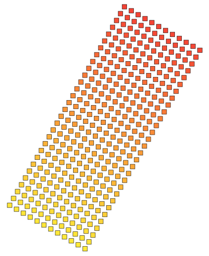

Changing the angle of a layout on a click animates the nodes in the Bloc connector (the demo `TLDemos exampleLayoutsAngle`).

### Circular layout

`TLCircularLayout` places the nodes on a circle. The gap is the length of the arc between two nodes, so that the circle grows with the number of nodes.

```smalltalk
| visualization |
visualization := TLVisualization fromEntities: (1 to: 24).
visualization nodeLabel: #asString.
visualization layout: (TLCircularLayout gap: 20).
visualization open.
```

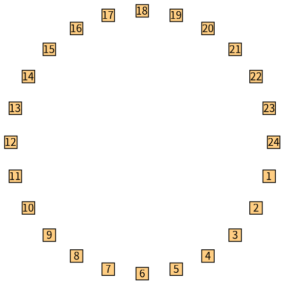

### Tree layout

`TLTreeLayout` places the nodes as a tree, from the connections between them. The roots are the nodes which have no incoming connection (or no outgoing one).

| Message | Meaning |
|---|---|
| `useOutgoingLinks` | The tree follows the connections from a node to the nodes it connects to: the roots are on top |
| `useIncomingLinks` | The default: the tree follows the connections the other way, and the roots are at the bottom, as in the connected tree of chapter 1 |
| `levelGap:` | The distance between two levels |
| `leavesGap:` | The distance between two nodes of the same level |
| `gap:` | Sets both |

The class-side `leftToRight`, `topToBottom`... of every layout also work for trees.

```smalltalk
| visualization |
visualization := TLVisualization fromEntities: (1 to: 15).
visualization nodeLabel: #asString.
visualization connectFollowingProperty: [ :number | { number * 2. number * 2 + 1 } select: [ :candidate | candidate <= 15 ] ].
visualization layout: (TLTreeLayout new
	useOutgoingLinks;
	levelGap: 40;
	leavesGap: 15;
	yourself).
visualization open.
```

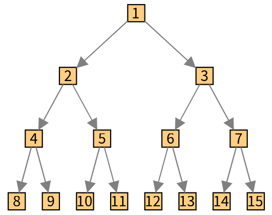

```smalltalk
| visualization |
visualization := TLVisualization fromEntities: (1 to: 15).
visualization nodeLabel: #asString.
visualization connectFollowingProperty: [ :number | { number * 2. number * 2 + 1 } select: [ :candidate | candidate <= 15 ] ].
visualization layout: (TLTreeLayout leftToRight
	useOutgoingLinks;
	yourself).
visualization open.
```

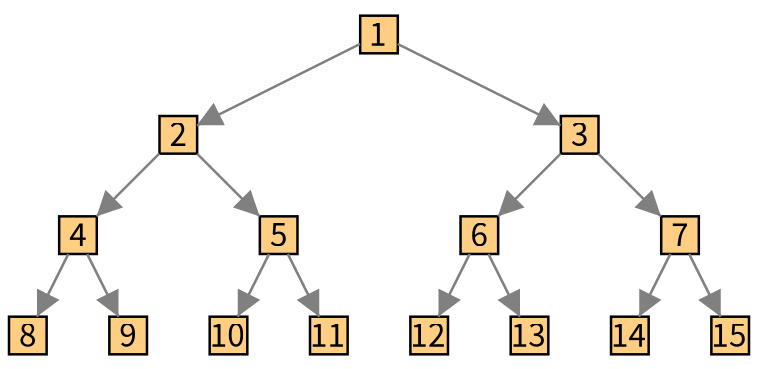

### Changing the layout of a displayed visualization

The layout of a group is a property you can change at any time. A layout applied again moves the nodes (the Bloc connector animates them):

```smalltalk
visualization layout: TLCircularLayout new.
visualization update.
```

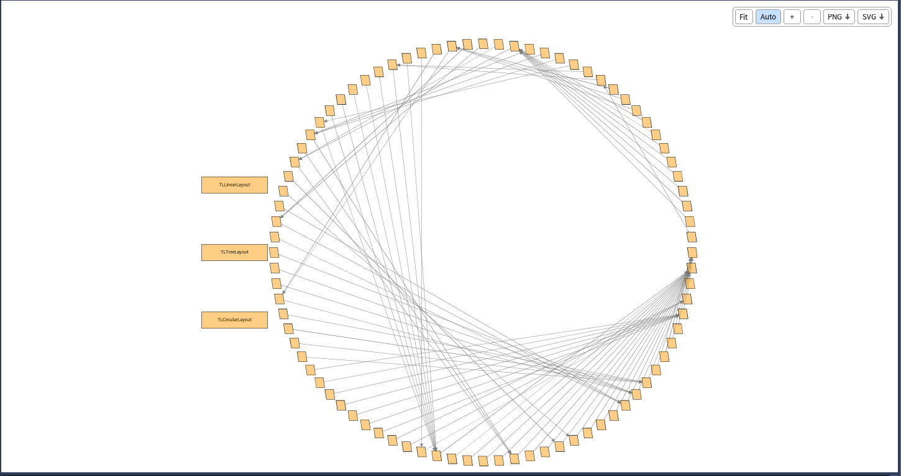

A layout you changed in place (`layout angle: 40`) needs `visualization requireLayoutApplication` before the `update`. Chapter 10 describes the update cycle.

### Node positions you decide

The `position:` property of a style sheet (chapter 4) fixes the position of a node relative to its group: the layout does not place the node, and uses it for placing the others. The `TLMemorizeNodePositionAction` (chapter 7) does it when the user moves a node.

## Sorting the nodes of a group

A layout uses the nodes in the order of the group. A *sorting strategy* orders them:

| Strategy | Order |
|---|---|
| `TLKeepingOrderStrategy new` | The order of creation (the default) |
| `TLComparableUsingStrategy new` | The entities themselves: they have to answer `<=` |
| `TLPropertyBasedStrategy onProperty: aBlock` | The value of a property of the entities. It is ascending, `descending` reverses it |
| `TLSortingBlockStrategy sortingBlock: [ :first :second | ... ]` | A sort block on the nodes |

```smalltalk
(visualization > #people) sortingStrategy: ((TLPropertyBasedStrategy onProperty: #age)
	descending;
	yourself).
```

`group sort: aBlock` sorts the nodes once. The children of the composite nodes are sorted with `childrenSortingStrategy:` of the node creation strategy (chapter 6).

## Writing a layout

A layout is a subclass of `TLLayout` which implements `executeOn: aGroup`. It places each node with `definePosition: aPoint forNode: aNode` (the point is the center of the node) and reads their size with `obtainsNodeDimension:`. `TLLayout class>>on:` is the entry point. Look at `TLLinearLayout` and `TLCircularLayout` for examples, and at `isConnectionDependant`, which a layout answers `true` when it needs the connections, as the tree layout does.
