# 4. Styling

## Style sheets

Every drawable has a style sheet: `drawable styleSheet`. A style sheet is a set of *properties* with values: `styleSheet backgroundColor: Color red`. The value of a property is a constant, or a block which receives the entity of the node and answers the value for it:

```smalltalk
visualization styleSheet
	backgroundColor: [ :number | number even ifTrue: [ Color lightGreen ] ifFalse: [ Color lightOrange ] ];
	width: [ :number | number * 10 ].
```

A drawable does not use its own style sheet alone. Its *effective* style sheet is built from its parents: the style of the visualization, then of its groups, then of the node. The nearest one wins. So the style of the whole visualization sets what is common, and a group or a node changes what differs:

```smalltalk
| visualization |
visualization := TLVisualization fromEntities: (1 to: 12).
visualization layout: (TLLinearLayout gap: 15 perLine: 6).
"The style of the whole visualization"
visualization styleSheet
	nodeLabel: #asString;
	backgroundColor: Color lightBlue;
	width: 40;
	height: 40.
"The style of one node"
(visualization nodeForEntity: 5) styleSheet backgroundColor: Color orange.
"A named style, added to the nodes which need it"
(visualization styleSheet > #warning)
	backgroundColor: Color red;
	borderWidth: 4;
	shape: TLEllipse.
(visualization nodeForEntity: 8) addStyle: #warning.
(visualization nodeForEntity: 9) addStyle: #warning.
visualization open.
```

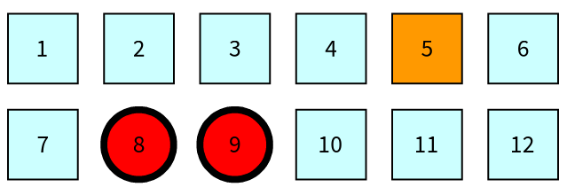

The order is, from the weakest to the strongest:

1. The default style sheet of Telescope (`TLStyleSheet default`).
2. The style sheets of the parents, from the visualization down to the parent of the node.
3. The *named styles* of the node, in the order in which they were added (`node addStyle: #name`).
4. The style sheet of the node.

### Substyles and named styles

`styleSheet > #name` answers the *substyle* of that name: another style sheet, which is created the first time. A substyle has two roles:

- **A named style**, which you add to the drawables which need it, as `#warning` above (`addStyle:` takes a symbol, and a drawable can have several). `removeStyle:` removes it.
- **A style for a part of the visualization.** Some names are known to Telescope:

| Substyle | Style of |
|---|---|
| `#connection` | The connections: `styleSheet > #connection color: Color blue` colors all of them |
| `#connection > #head` | The head of the connections (shape and color) |
| `#children` | The children of the composite nodes (chapter 6) |
| `#shapeInteraction` | The shape triggers (chapter 7) |
| `#base`, `#middle`, `#middleReversed` of a connection | Arrows at the start and at the middle of a connection (Bloc connector, chapter 5) |

The style sheet of a connection is that of the connection itself: `connection styleSheet`.

### Values which depend on the entity

When the value is a block, it is evaluated for each node with its entity. `Color`, numbers, symbols and classes are constants. A symbol is a constant for the properties which take one (a label position, a wrapping mode...), and a selector sent to the entity for the ones which take a text (the label).

A *gradient* gives a color from a number:

```smalltalk
| visualization |
visualization := TLVisualization new.
(visualization > #color) addNodesFromEntities: (1 to: 60).
(visualization > #color) styleSheet
	backgroundColor: ((MDLColor red property: #yourself gradientAt: 5)
		to: MDLColor orange at: 15;
		to: MDLColor yellow at: 30;
		to: MDLColor green at: 50).
(visualization > #gray) addNodesFromEntities: (1 to: 10).
(visualization > #gray) styleSheet
	backgroundColor: ((MDLColor white property: #yourself gradientAt: 1) to: MDLColor black at: 10).
visualization open.
```

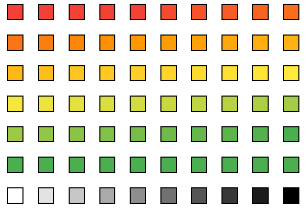

`(MDLColor red property: #yourself gradientAt: 5) to: MDLColor orange at: 15` is a `TLGradient`: the property is read on the entity (`#yourself` here) and the color is interpolated between the colors given at each level. It is used as the value of `backgroundColor` or `borderColor`, and it can be described by a legend (chapter 8).

### Changing a style when the visualization is displayed

The style sheets are read when the connector draws a drawable. After a change, tell the drawable that it has to be drawn again, and update the visualization:

```smalltalk
node styleSheet backgroundColor: Color green.
node requireUpdate.
visualization update.
```

The interactions which change a style (`TLStyleCustomizationAction`, chapter 7) do it for you.

## The properties of a node

### Shape

| Property | Value |
|---|---|
| `shape:` | A shape class, or a block which answers one. The default is `TLRectangle` |
| `onlyLabelForNodes` | The same as `shape: TLNoShape`: the nodes are only their label |

The shapes of the nodes are `TLRectangle` (the default), `TLEllipse` (a circle when the width and the height are equal), `TLDiamond`, `TLTriangle`, `TLRhomboid`, `TLStar`, `TLVee`, `TLPentagon`, `TLHexagon`, `TLHeptagon`, `TLOctagon`, `TLFileShape`, `TLFolderShape`, `TLLabel` and `TLNoShape`. `TLCircle`, `TLSquare` and `TLArrow` are for the heads of the connections (chapter 5). Not all connectors support all of them: `visualization generator nodesShapesAvailableForConnector` lists the ones of the current connector, and `connectionHeadShapesAvailableForConnector` the ones which can be a head.

```smalltalk
| visualization |
visualization := TLVisualization new.
visualization styleSheet
	width: 40;
	height: 40;
	nodeLabel: #displayName.
visualization layout: TLCircularLayout.
visualization generator nodesShapesAvailableForConnector do: [ :shape | (visualization addNodeFromEntity: shape) styleSheet shape: shape ].
visualization open.
```

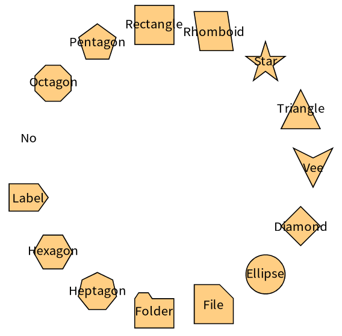

### Colors and border

| Property | Value |
|---|---|
| `backgroundColor:` | The color of the node, or a gradient |
| `borderColor:` | The color of the border |
| `borderWidth:` | The width of the border in pixels. The default is 1 |
| `borderStyle:` | A line style: `TLSolidLineStyle` (default), `TLDashedLineStyle`, `TLDottedLineStyle` or `TLDoubleLineStyle` |

```smalltalk
| visualization |
visualization := TLVisualization fromEntities: (1 to: 8).
visualization styleSheet
	nodeLabel: #asString;
	width: 60;
	height: 40;
	shape: TLEllipse;
	backgroundColor: [ :number | number even ifTrue: [ Color lightGreen ] ifFalse: [ Color lightOrange ] ];
	borderColor: [ :number | number isPrime ifTrue: [ Color blue ] ifFalse: [ Color black ] ];
	borderWidth: 3.
visualization layout: (TLLinearLayout gap: 20 perLine: 4).
visualization open.
```

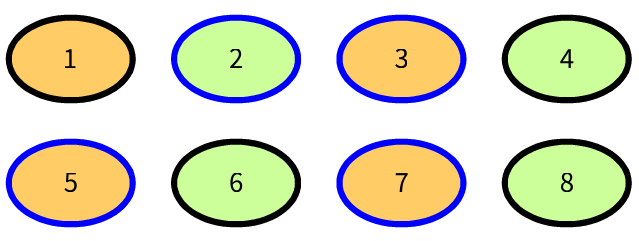

```smalltalk
| visualization |
visualization := TLVisualization new.
visualization styleSheet
	width: 90;
	height: 60;
	borderWidth: 4;
	nodeLabel: [ :lineStyle | (lineStyle name copyReplaceAll: 'LineStyle' with: '') allButFirst: 2 ] position: #bottom;
	backgroundColor: Color white.
{ TLSolidLineStyle. TLDashedLineStyle. TLDottedLineStyle. TLDoubleLineStyle } do: [ :lineStyle |
	(visualization addNodeFromEntity: lineStyle) styleSheet borderStyle: lineStyle ].
visualization layout: (TLLinearLayout gap: 25).
visualization open.
```

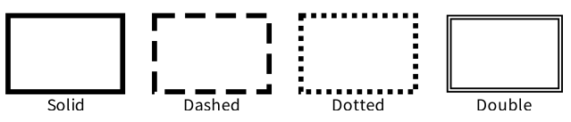

### Size

| Property | Value |
|---|---|
| `width:`, `height:` | A number of pixels, or a block. The default is 15 |
| `adaptNodeWidthFromLabel` | The width of a node is the width of its label. `adaptNodeWidthFromLabelWithDefault: 20` gives the width of a node whose label is empty |
| `takeAllSpace:` (or `occupyMaximumSpace`) | `true` for a node which is as high as the highest node of its line in a linear layout. It can be a block |

```smalltalk
| visualization |
visualization := TLVisualization fromEntities: (1 to: 8).
visualization styleSheet
	nodeLabel: #asString;
	width: [ :number | number * 10 + 20 ];
	height: [ :number | number * 5 + 20 ];
	backgroundColor: Color lightBlue.
visualization layout: (TLLinearLayout gap: 15).
visualization open.
```

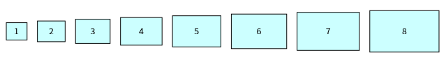

```smalltalk
| visualization |
visualization := TLVisualization fromEntities: ((0 to: 10) collect: [ :number | Character alphabet first: number * 2 ]).
visualization styleSheet
	nodeLabel: #asString;
	adaptNodeWidthFromLabelWithDefault: 20.
visualization layout: (TLLinearLayout gap: 10 maximumDimension: 600).
visualization open.
```

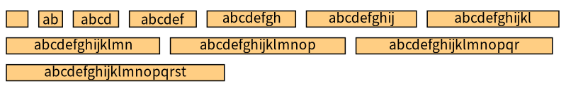

```smalltalk
| visualization |
visualization := TLVisualization new.
visualization styleSheet
	width: 50;
	height: [ :entity | 30 + (entity \\ 4 * 25) ];
	nodeLabel: #yourself;
	layout: ((TLLinearLayout perLine: 4) gap: 15; yourself);
	takeAllSpace: [ :entity | entity odd ].
visualization addNodesFromEntities: (1 to: 12).
visualization open.
```

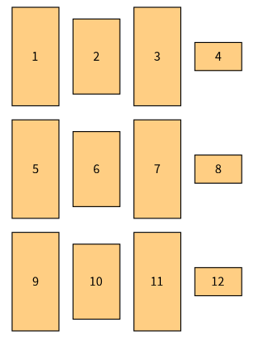

### Position

`position:` fixes the position of a node relative to its group. The layout of the group does not place a node which has one. Interactions set it when the user moves a node (chapter 7).

## The label of a node

| Property | Value |
|---|---|
| `nodeLabel:` | What is displayed: a symbol (a message sent to the entity), a block, or a string |
| `nodeLabel:position:` | The same, with the position |
| `nodeLabelPosition:` | `#inside` (the default), `#top`, `#bottom`, `#left`, `#right`, a `TLPosition`, or a block which answers one |
| `noNodeLabel` | The node has no label |
| `labelSize:` | The size of the text. A number or a block |
| `textColor:` | The color of the text. A color or a block |
| `nodeLabelWrap:` | `'wrap'` breaks a long label in several lines, `'ellipsis'` cuts it with three dots |
| `nodeLabelMaxWidth:` | The width in pixels at which `nodeLabelWrap:` breaks or cuts |

A `TLPosition` has a horizontal and a vertical part: `TLPosition new horizontal: #left; vertical: #top; yourself`. The horizontal values are `#left`, `#center` and `#right`, the vertical ones `#top`, `#center` and `#bottom`.

```smalltalk
| visualization |
visualization := TLVisualization new.
#(top center bottom) do: [ :vertical | #(left center right) do: [ :horizontal | visualization addNodeFromEntity: vertical -> horizontal ] ].
visualization layout: (TLLinearLayout gap: 50 perLine: 3).
visualization styleSheet
	nodeLabel: #asString
	position: [ :association | TLPosition new horizontal: association value; vertical: association key; yourself ].
visualization open.
```

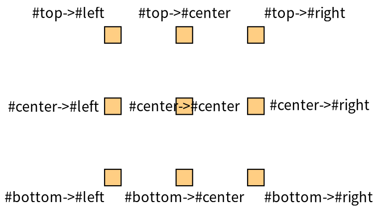

```smalltalk
| visualization noWrap automaticWrap forcedWrap |
visualization := TLVisualization new.
visualization styleSheet
	width: 40;
	height: 40;
	layout: ((TLLinearLayout perLine: 3) gap: 150; yourself);
	nodeLabel: #yourself position: #top.
noWrap := visualization addNodeFromEntity: 'This is a node without wrap'.
automaticWrap := visualization addNodeFromEntity: 'This is a node with an automatic wrap'.
automaticWrap styleSheet
	nodeLabelWrap: 'wrap';
	nodeLabelMaxWidth: 100.
forcedWrap := visualization addNodeFromEntity: 'ThisIsANodeWithAForcedWrap'.
forcedWrap styleSheet
	nodeLabelWrap: 'wrap';
	nodeLabelMaxWidth: 100;
	nodeLabel: [ :string | string insertLineReturnEvery: 8 ].
visualization open.
```

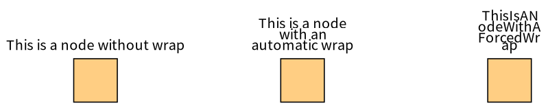

```smalltalk
| visualization |
visualization := TLVisualization fromEntities: #(#small #medium #large).
visualization styleSheet
	nodeLabel: #asString position: #inside;
	labelSize: [ :name | name size * 4 ];
	textColor: [ :name | name = #large ifTrue: [ Color red ] ifFalse: [ Color black ] ];
	width: 120;
	height: 60.
visualization layout: (TLLinearLayout gap: 30).
visualization open.
```

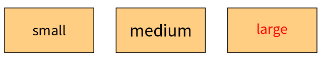

## The layout properties

| Property | Value |
|---|---|
| `layout:` | The layout of a group: how it places its nodes (chapter 3) |
| `childrenLayout:` | The layout of the children of a composite node (chapter 6) |

## The properties of a connection

The connections have their own properties, in the style sheet of the connection or in the substyle `#connection` of a group: color, width, curve style, line style, label, head and arrows. Chapter 5 describes them.

## The properties of the interactions

| Property | Value |
|---|---|
| `triggerPosition:` | Where the shape triggers are, relative to their node: `#right` by default (chapter 7) |

## The default style sheet

Telescope gives these values when nothing else does:

| Property | Default |
|---|---|
| `backgroundColor` | A translucent orange |
| `borderColor`, `textColor` | Black |
| `borderWidth` | 1 |
| `width`, `height` | 15 |
| `shape` | `TLRectangle` |
| `labelSize` | 14 |
| `nodeLabelPosition` | `#inside` |
| `layout` | `TLLinearLayout gap: 15 maximumDimension: 300` |
| `childrenLayout` | `TLLinearLayout gap: 5 maximumDimension: 50` |
| `compositeExpandedByDefault` | `false` |
| `takeAllSpace` | `false` |
| `triggerPosition` | `#right` |
| `#connection` | Gray, 1 pixel, `TLBezierCurve`, with a `TLTriangle` head |
| `#shapeInteraction` | Light blue ellipse of 8 by 8 pixels, without label |

`TLStyleSheet default` builds a new style sheet with these values, that you can inspect.
