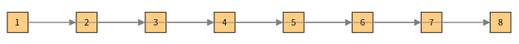
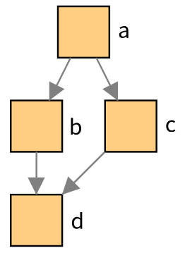
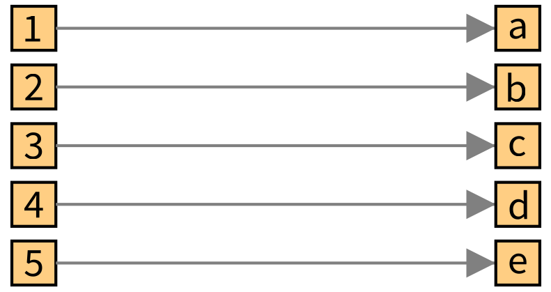
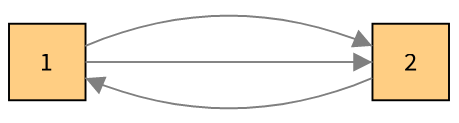
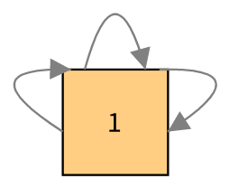
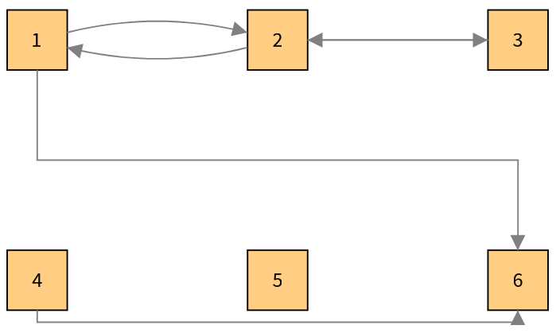
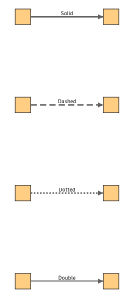
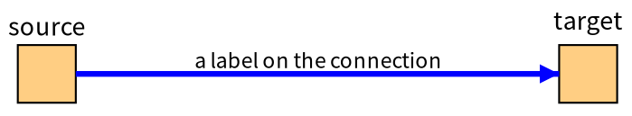
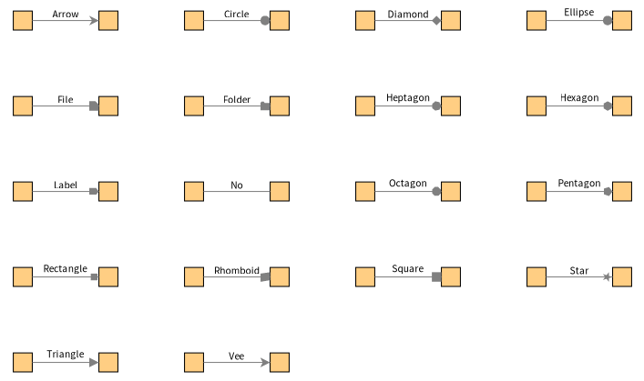
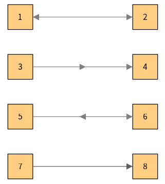

# 5. Connections

A *connection* is a link between two nodes. It is a drawable with its own style sheet and interactions. It leaves a node (`fromNode`) and arrives on another (`toNode`), and the connector draws a line, with a head at the end.

## Creating connections

Every creating message answers the connection or the connections it made.

| Message | What it does |
|---|---|
| `node connectTo: anotherNode` | A connection from the node to another one |
| `node connectFrom: anotherNode` | A connection from another node to this one |
| `node connectToAll: nodes` | A connection to each node of the collection |
| `node connectTo: anotherNode entity: anEntity` | A connection which is itself an entity of your model (`connection entity`) |
| `group connectFollowingProperty: aBlockOrSymbol` | For each node, a connection to the nodes of the entities which the block answers for its entity |
| `group connectFollowingProperty: aBlock context: nodes` | The same, looking for the targets in these nodes only: the nodes of another group, for example |
| `group connectThrough: aConnectionsBlock to: aTargetBlock` | The block answers the *connection entities* of a node, and the second one the target entity of each of them |
| `connectIfNotTo:`, `connectIfNotAlreadyFollowingProperty:`... | The same messages which do not connect two nodes which already are |

`connectFollowingProperty:` is the usual message when the model knows its neighbors:

```smalltalk
| visualization |
visualization := TLVisualization fromEntities: (1 to: 8).
visualization styleSheet
	nodeLabel: #asString;
	width: 30;
	height: 30.
visualization connectFollowingProperty: [ :number | { number + 1. number + 2 } select: [ :candidate | candidate <= 8 ] ].
visualization layout: (TLLinearLayout gap: 70).
visualization open.
```



`connectThrough:to:` is for models where the links are objects:

```smalltalk
| visualization links |
visualization := TLVisualization new.
visualization styleSheet
	nodeLabel: #asString position: #right;
	width: 30;
	height: 30.
visualization addNodesFromEntities: #('a' 'b' 'c' 'd').
"The links are entities of the model: here associations"
links := { 'a' -> 'b'. 'a' -> 'c'. 'b' -> 'd'. 'c' -> 'd' }.
visualization
	connectThrough: [ :letter | links select: [ :link | link key = letter ] ]
	to: [ :link | link value ].
visualization layout: (TLTreeLayout new useOutgoingLinks; yourself).
visualization open.
```



Between two groups, the target entities are looked for in the *context*:



## The API of a connection

| Message | Answers |
|---|---|
| `connection fromNode`, `toNode`, `connectedNodes` | The nodes at its ends |
| `connection entity` | The entity of a connection made with an entity |
| `connection styleSheet` | Its style |
| `connection hide`, `show` | Hide it, show it again |
| `connection removed` | Removes it from the nodes it joins |
| `connection addInteraction:` | Gives it an interaction (the nodes do not give theirs to their connections) |
| `node outgoingConnections`, `incomingConnections`, `allConnections` | The connections of a node |

Several connections can join the same two nodes, and a node can be connected to itself:

```smalltalk
| visualization first second |
visualization := TLVisualization new.
visualization styleSheet
	width: 40;
	height: 40;
	nodeLabel: #asString.
visualization layout: (TLLinearLayout gap: 150).
first := visualization addNodeFromEntity: 1.
second := visualization addNodeFromEntity: 2.
first connectTo: second.
first connectTo: second.
second connectTo: first.
visualization open.
```



```smalltalk
| visualization node |
visualization := TLVisualization new.
visualization styleSheet
	width: 50;
	height: 50;
	nodeLabel: #asString.
node := visualization addNodeFromEntity: 1.
node connectTo: node.
node connectTo: node.
node connectTo: node.
visualization open.
```



The Bloc connector spreads the connections which join the same nodes so that they do not overlap, and draws a loop for a connection from a node to itself.

## Style

The style of a connection comes from its style sheet, from the substyle `#connection` of its parents, and from the defaults (gray, one pixel, Bézier curve, triangle head).

| Property | Value |
|---|---|
| `color:` | The color of the line |
| `width:` | The width of the line |
| `curveStyle:` | `TLBezierCurve` (default), `TLDirectCurve` or `TLSegmentsCurve` |
| `connectionLineStyle:` | `TLSolidLineStyle` (default), `TLDashedLineStyle`, `TLDottedLineStyle` or `TLDoubleLineStyle` |
| `connectionLabel:` | A label displayed next to the line: a block or a string |
| `connectionLabelSize:` | The size of this label |
| `connectionStyle:` | The name of a style to apply to the connections which an action creates (see `TLConnectAction`, chapter 7) |
| `> #head` | The head: `(connection styleSheet > #head) shape: TLCircle; color: Color red` |

To style all the connections of a group at once, use its substyle: `(group styleSheet > #connection) color: Color blue`.

### Curves

- **`TLBezierCurve`**, the default, is a straight line when a connection is alone between two nodes, and an arc when other connections join the same nodes, so that they are all visible.
- **`TLDirectCurve`** is always a straight line.
- **`TLSegmentsCurve`** has right angles. The Bloc connector makes it go around the nodes which are in its way.

```smalltalk
| visualization nodes |
visualization := TLVisualization new.
visualization styleSheet
	width: 40;
	height: 40;
	nodeLabel: #asString;
	layout: ((TLLinearLayout perLine: 3) gap: 120; yourself).
nodes := (1 to: 6) collect: [ :entity | visualization addNodeFromEntity: entity ].
"Bezier is the default: a line, and arcs when several connections join the same nodes"
(nodes at: 1) connectTo: (nodes at: 2).
(nodes at: 2) connectTo: (nodes at: 1).
"Direct lines are always straight"
((nodes at: 2) connectTo: (nodes at: 3)) styleSheet curveStyle: TLDirectCurve.
((nodes at: 3) connectTo: (nodes at: 2)) styleSheet curveStyle: TLDirectCurve.
"Segments have right angles and go around the other nodes"
((nodes at: 1) connectTo: (nodes at: 6)) styleSheet curveStyle: TLSegmentsCurve.
((nodes at: 4) connectTo: (nodes at: 6)) styleSheet curveStyle: TLSegmentsCurve.
visualization open.
```



### Line styles and labels

```smalltalk
| visualization |
visualization := TLVisualization new.
visualization styleSheet
	width: 30;
	height: 30.
visualization layout: (TLLinearLayout gap: 140 perLine: 2).
{ TLSolidLineStyle. TLDashedLineStyle. TLDottedLineStyle. TLDoubleLineStyle } do: [ :lineStyle | | connection |
	connection := (visualization addNodeFromEntity: lineStyle) connectTo: (visualization addNodeFromEntity: lineStyle name).
	connection styleSheet
		connectionLineStyle: lineStyle;
		connectionLabel: [ (lineStyle name copyReplaceAll: 'LineStyle' with: '') allButFirst: 2 ];
		connectionLabelSize: 11;
		width: 3;
		color: Color darkGray ].
visualization open.
```



```smalltalk
| visualization first second connection |
visualization := TLVisualization new.
visualization layout: (TLLinearLayout gap: 250).
first := visualization addNodeFromEntity: 'source'.
second := visualization addNodeFromEntity: 'target'.
visualization styleSheet
	width: 30;
	height: 30;
	nodeLabel: #asString position: #top.
connection := first connectTo: second.
connection styleSheet
	connectionLabel: [ 'a label on the connection' ];
	connectionLabelSize: 12;
	color: Color blue;
	width: 3.
visualization open.
```



### Heads and arrows

The head is at the end of the line and is a triangle by default. Any shape the connector can use as a head is possible, `TLNoShape` removes it:

```smalltalk
| visualization |
visualization := TLVisualization new.
visualization styleSheet
	width: 20;
	height: 20.
visualization layout: (TLLinearLayout gap: 70 perLine: 8).
visualization generator connectionHeadShapesAvailableForConnector do: [ :shape | | connection |
	connection := (visualization addNodeFromEntity: shape) connectTo: (visualization addNodeFromEntity: shape displayName).
	connection styleSheet
		connectionLabel: [ shape displayName ];
		connectionLabelSize: 11.
	connection styleSheet > #head shape: shape ].
visualization open.
```



The Bloc connector also draws arrows at the start of the line and at its middle, from three more substyles of the connection. An arrow is drawn when its substyle has a shape, and has the color of the line unless the substyle has its own:

| Substyle | Arrow |
|---|---|
| `#base` | At the start of the line, pointing into the source node |
| `#middle` | On the middle of the line, pointing along it |
| `#middleReversed` | On the middle of the line, pointing backwards |

```smalltalk
| visualization |
visualization := TLVisualization new.
visualization styleSheet
	width: 40;
	height: 40;
	nodeLabel: #yourself;
	layout: ((TLLinearLayout perLine: 2) horizontalGap: 160; verticalGap: 40; yourself).
(((visualization addNodeFromEntity: 1) connectTo: (visualization addNodeFromEntity: 2)) styleSheet > #base) shape: TLTriangle.
(((visualization addNodeFromEntity: 3) connectTo: (visualization addNodeFromEntity: 4)) styleSheet > #middle) shape: TLTriangle.
(((visualization addNodeFromEntity: 5) connectTo: (visualization addNodeFromEntity: 6)) styleSheet > #middleReversed) shape: TLTriangle.
((visualization addNodeFromEntity: 7) connectTo: (visualization addNodeFromEntity: 8)) styleSheet
	curveStyle: TLSegmentsCurve;
	color: Color darkGray.
visualization open.
```



## Connections of the children of a composite node

`compositeNode connectChildrenFollowingProperty:` connects the children of a composite node among themselves (chapter 6).

## Removing, hiding and showing

`connection hide` and `connection show` hide and show a connection without losing it; `TLHideAction` and `TLShowAction` do it from an interaction (chapter 7). A connection to a hidden node is hidden too. `connection removed` removes a connection, and `node remove` removes a node with its connections.
