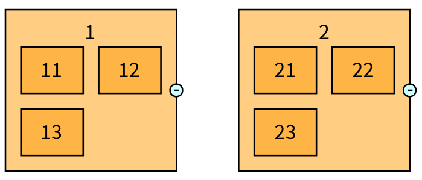
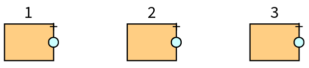
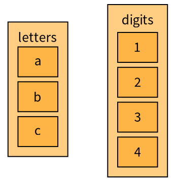
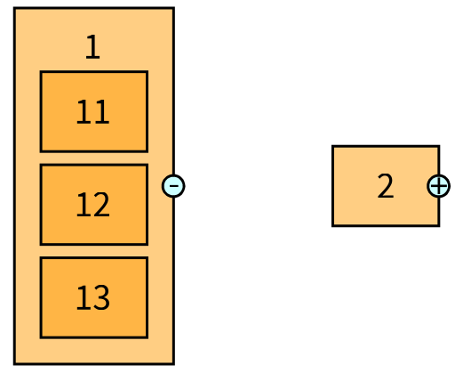
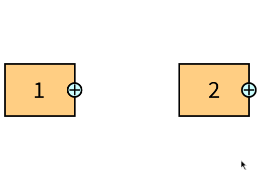
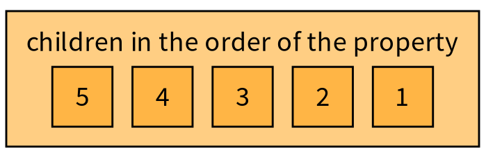

# 6. Composite nodes

A *composite node* is a node which contains other nodes: a class and its methods, a package and its classes, a folder and its files. Its children are a group of nodes, placed by their own layout, and the composite node is as big as its children and the space around them.

## Creating composite nodes

Tell the group how to find the children of an entity, and every node it creates for an entity which has children is a composite node:

```smalltalk
visualization childrenProperty: [ :number | number < 10 ifTrue: [ { number * 10 + 1. number * 10 + 2 } ] ifFalse: [ #() ] ].
```

`childrenProperty:` takes a block or a symbol which answers the children entities. An entity with no child gives a simple node. The children are created with the same property: with `visualization nodeCreationStrategy beRecursive`, the children of the children are composite nodes too (the example below stops when the number is 10 or more).

```smalltalk
| visualization |
visualization := TLVisualization new.
visualization styleSheet
	nodeLabel: #asString position: #inside;
	width: 40;
	height: 30;
	compositeExpandedByDefault: true;
	childrenLayout: (TLLinearLayout gap: 10 perLine: 2).
visualization childrenProperty: [ :number | number < 10 ifTrue: [ { number * 10 + 1. number * 10 + 2. number * 10 + 3 } ] ifFalse: [ #() ] ].
visualization nodeCreationStrategy beRecursive.
visualization addNodesFromEntities: #(1 2).
visualization addCompositeDefaultCollapseInteraction.
visualization layout: (TLLinearLayout gap: 40).
visualization open.
```



The node of an entity which has children is collapsed or expanded. When it is collapsed, its children are not displayed and it is as big as a simple node:

```smalltalk
| visualization |
visualization := TLVisualization new.
visualization styleSheet
	nodeLabel: #asString position: #top;
	width: 40;
	height: 30;
	compositeExpandedByDefault: false.
visualization childrenProperty: [ :number | number < 10 ifTrue: [ { number * 10 + 1. number * 10 + 2 } ] ifFalse: [ #() ] ].
visualization addNodesFromEntities: #(1 2 3).
visualization addCompositeDefaultCollapseInteraction.
visualization layout: (TLLinearLayout gap: 60).
visualization open.
```



You can also create a composite node explicitly, without a property:

```smalltalk
| visualization |
visualization := TLVisualization new.
visualization styleSheet
	nodeLabel: #asString position: #inside;
	width: 40;
	height: 30;
	compositeExpandedByDefault: true.
visualization addCompositeNodeFromEntity: 'letters' children: #('a' 'b' 'c').
visualization addCompositeNodeFromEntity: 'digits' children: #('1' '2' '3' '4').
visualization layout: (TLLinearLayout gap: 40).
visualization open.
```



## Expanded or collapsed

| Style property | Meaning |
|---|---|
| `compositeExpandedByDefault: true` | The composite nodes start expanded. The default is `false` |
| `expandCompositeNodes` | The same as `compositeExpandedByDefault: true` |

`compositeNode expanded` and `isExpanded` tell the state, `expanded: aBoolean` changes it. To let the user do it, add the interaction of chapter 7: either one which you place yourself,

```smalltalk
visualization addInteraction: TLExpandCollapseCompositeNodeAction onCompositeNodeWithChildren onClick.
```

or the default one, which adds a small trigger on each composite node, with a + when it is collapsed and a - when it is expanded:

```smalltalk
visualization addCompositeDefaultCollapseInteraction.
```

```smalltalk
| visualization |
visualization := TLVisualization new.
visualization styleSheet
	nodeLabel: #asString position: #inside;
	width: 40;
	height: 30;
	compositeExpandedByDefault: false.
visualization childrenProperty: [ :number | number < 10 ifTrue: [ { number * 10 + 1. number * 10 + 2. number * 10 + 3 } ] ifFalse: [ #() ] ].
visualization addNodesFromEntities: #(1 2).
visualization addCompositeDefaultCollapseInteraction.
visualization layout: (TLLinearLayout gap: 60).
visualization open.
```





A composite node does not give its interactions to its children, unless you ask: `interaction propagateToChildren` makes the children inherit it (the click then acts on the composite node). A click on a child is for the child, not for its composite node.

## Styling the children

The children of the composite nodes have their own substyle, `#children`, with the layout of the children:

| Property | Meaning |
|---|---|
| `childrenLayout:` | The layout of the children. The default is `TLLinearLayout gap: 5 maximumDimension: 50` |
| `styleSheet > #children` | The style of the children (colors, label, size...) |
| `beChildrenRecursive` | The children use the same style as their parent. Careful with `compositeExpandedByDefault`: it can loop forever |

A label placed `#inside` a composite node is placed in a header above the children. The width of the node follows its label when the label is wider than the children.

## Children order

The children are in the order of the property. A sorting strategy of the node creation strategy sorts them (chapter 3):

```smalltalk
| visualization |
visualization := TLVisualization new.
visualization styleSheet
	nodeLabel: [ :entity | entity isCollection ifTrue: [ 'children in the order of the property' ] ifFalse: [ entity asString ] ] position: #inside;
	width: 30;
	height: 30;
	compositeExpandedByDefault: true;
	childrenLayout: (TLLinearLayout gap: 10).
visualization nodeCreationStrategy
	compositeProperty: #yourself;
	childrenSortingStrategy: ((TLPropertyBasedStrategy onProperty: #yourself)
		descending;
		yourself).
visualization addNodeFromEntity: #(3 1 4 5 2).
visualization open.
```



The node creation strategy has `compositeProperty:`, `compositeChildrenLayout:` and `childrenSortingStrategy:` to set it all at once.

## The API of a composite node

| Message | Answers |
|---|---|
| `compositeNode childrenNodes` | The children nodes |
| `compositeNode childrenGroup` | The group which contains them: you can give it a layout, a style and interactions |
| `compositeNode hasChildren`, `hasChildrenToDisplay` | Whether it has children, and whether they are displayed (it is expanded) |
| `compositeNode allChildrenNodesRecursivelyDo:` | Visits all the descendants |
| `compositeNode leafs` | The leaves of the tree under the node |
| `compositeNode connectChildrenFollowingProperty:` | Connects the children among themselves |
| `compositeNode addChildNodeFromEntity:` | Adds a child |
| `compositeNode removeChild:` | Removes a child |
| `simpleNode becomeComposite` | Turns a simple node into a composite node |

## Not available yet

`showChildrenConnectionsOnParent`, which would show the connections between the children of a collapsed composite node on the node, is not implemented by Telescope and no connector supports it.
