# 7. Interactions

An *interaction* says when something happens, and an *action* says what happens. You build an interaction from an action, then you give it to a drawable (a node, a group, a connection):

```smalltalk
action := TLStyleCustomizationAction custom: [ :style | style backgroundColor: Color red ].
visualization addInteraction: action onMouseOver.
```

`onMouseOver` makes the interaction from the action, `addInteraction:` gives it. An interaction given to a group is inherited by all the nodes of the group, and by the nodes of its sub groups. It is not inherited by the connections, which need their own, and a composite node gives its interactions to its children only on request (`propagateToChildren`, chapter 6).

| Message | What it does |
|---|---|
| `drawable addInteraction: anInteraction` | Gives the interaction. It answers the interaction |
| `drawable addInteractions: aCollection` | Gives several |
| `drawable interactions` | The interactions the drawable has |
| `drawable allInteractions` | These ones, and the inherited ones |
| `drawable removeAllInteractions` | Removes them |
| `interaction condition: aBlock` | The interaction only occurs on the drawables for which the block, which receives the drawable, answers `true` |
| `interaction propagateToChildren` | The children of a composite node inherit the interaction |

`TLCustomAction block: [ :node | ... ] condition: [ :node | ... ]` creates an action with its condition.

## When: the kinds of interaction

| Interaction | Created by | When |
|---|---|---|
| Mouse over | `action onMouseOver` | The mouse enters the drawable. The action is done again, reversed, when the mouse leaves it: only the *reversible* actions can be used |
| Click | `action onClick` | The drawable is clicked |
| Double click | `action onDoubleClick` | It is double clicked |
| Right click | `action onRightClick` | It is clicked with the secondary button |
| Menu | `action withMenu: 'Title'` | The user chooses an entry of the menu of the drawable |
| Menu with choices | `action withMultipleChoices: aBlock menu: 'Title'` | The entry opens a submenu of choices |
| Drop | `action onDrop` | The user drops another node on the drawable |
| Moved | `action onMove` | The user moved the node |
| External trigger | `action onExternalTrigger` | Your application asks for it |
| Shape trigger | `action withTriggerStyle: aBlock` | A small shape on the node is clicked |

`TLReversibleNodeAction onMouseOver` is the shortcut for `TLReversibleNodeAction new onMouseOver`, and every action class understands `onClick` on the class side.

### Mouse over

The mouse over interactions apply an action when the mouse enters the drawable and undo it when it leaves.

```smalltalk
| visualization |
visualization := TLVisualization fromEntities: (1 to: 12).
visualization nodeLabel: #asString.
visualization layout: (TLLinearLayout gap: 15 perLine: 4).
visualization addInteraction: (TLStyleCustomizationAction custom: [ :style |
	style
		backgroundColor: Color red;
		borderColor: Color red darker ]) onMouseOver.
visualization open.
```

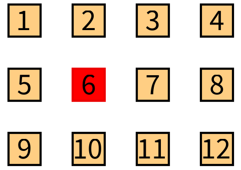

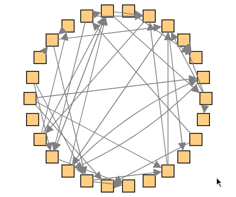

### Click and double click

The action of a click interaction runs when the node is clicked. The click which ends the drag of a node is not a click.

### Menus

`withMenu:` adds an entry to the menu which opens with a right click, on the node. The menu has one entry per interaction with a menu:

```smalltalk
| visualization |
visualization := TLVisualization fromEntities: (1 to: 8).
visualization nodeLabel: #asString.
visualization layout: (TLLinearLayout gap: 15 perLine: 4).
visualization addInteraction: (TLInspectAction withMenu: 'Inspect the number').
visualization addInteraction: ((TLCustomAction block: [ :node | node entity crTrace ]) withMenu: 'Print on the Transcript').
visualization open.
```

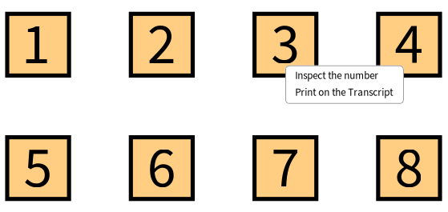

`withMultipleChoices:menu:` adds an entry which opens a submenu of choices, which a block computes for the node. The action receives the node and the choice, so it is a `TLCustomWithParameterAction`:

```smalltalk
| visualization |
visualization := TLVisualization fromEntities: #(#Henry #John #Catherine #Paule #Isabel).
visualization layout gap: 40.
visualization styleSheet nodeLabel: #asString position: #top.
visualization addInteraction: ((TLCustomWithParameterAction block: [ :node :choice |
	Transcript show: node entity asString; show: ' wants '; show: choice; cr ])
	withMultipleChoices: [ :node | #('french fries' 'potatoes' 'mashed potatoes' 'baked potatoes') ]
	menu: 'Choose your dish').
visualization open.
```

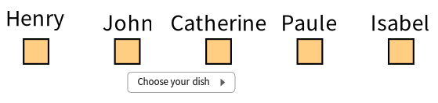

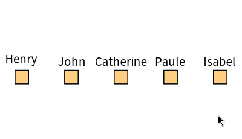

A right click interaction (`onRightClick`) takes the right click: the menu does not open on a node which has one.

### Pop ups

`TLPopUpAction` shows a text near the node. `onMouseOver` shows it while the mouse is over the node, `onClick` shows it after a click and hides it with the next one. `TLPopUpAction text: aBlockOrSymbol` takes the text from the entity, and `text:position:` takes the position of the pop up around the node (a `TLPosition`, or a block, as for a label).

```smalltalk
| visualization |
visualization := TLVisualization fromEntities: (1 to: 12).
visualization nodeLabel: #asString.
visualization layout: (TLLinearLayout gap: 15 perLine: 4).
visualization addInteraction: (TLPopUpAction text: [ :number | 'The number ' , number asString , ' is ' , (number even ifTrue: [ 'even' ] ifFalse: [ 'odd' ]) ]) onMouseOver.
visualization open.
```

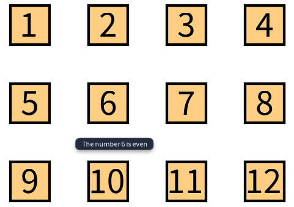

```smalltalk
| visualization |
visualization := TLVisualization new.
#(top center bottom) do: [ :vertical | #(left center right) do: [ :horizontal | visualization addNodeFromEntity: vertical -> horizontal ] ].
visualization layout: (TLLinearLayout gap: 90 perLine: 3).
visualization addInteraction: (TLPopUpAction
	text: #asString
	position: [ :association | TLPosition new horizontal: association value; vertical: association key; yourself ]) onClick.
visualization open.
```

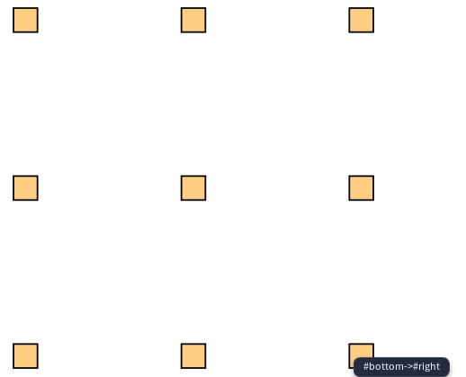

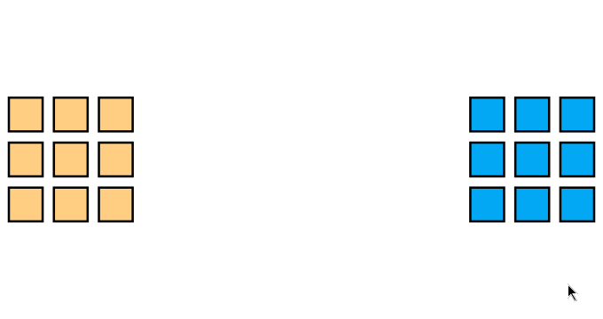

`drawable mouseOverPopUp` is a shortcut for the pop up which shows the label of the entity.

### Drag and drop, moving nodes

A user can drag the nodes. Two interactions react:

- **`onMove`** runs when the user drops a node after dragging it. The action receives the node and the new position of its center, so it is a `TLCustomWithParameterAction`. `TLMemorizeNodePositionAction onMove` makes the node keep that position: the layout does not place it anymore, and still counts it to place the others.
- **`onDrop`** runs on the node under the mouse when another node is dropped on it, with the dropped node as the parameter.

```smalltalk
| visualization |
visualization := TLVisualization fromEntities: ((1 to: 5) collect: [ :index | (index * 20) @ (index * 20) ]).
visualization addInteractions: {
	(TLCustomWithParameterAction block: [ :node :position | node entity: position x asInteger @ position y asInteger ]) onMove.
	TLMemorizeNodePositionAction onMove }.
visualization styleSheet
	nodeLabel: #asString position: #top;
	labelSize: 10.
visualization open.
```

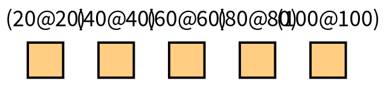

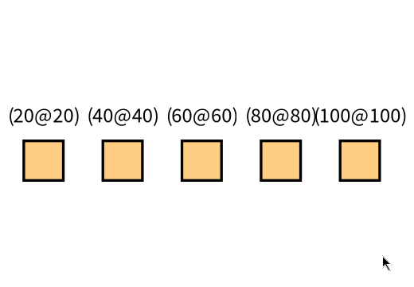

```smalltalk
| visualization |
visualization := TLVisualization new.
visualization layout: (TLLinearLayout leftToRight gap: 250; yourself).
visualization styleSheet nodeLabel: #asString position: #top.
(visualization > #people)
	layout: (TLLinearLayout topToBottom gap: 40; yourself);
	addNodesFromEntities: #('Alice' 'Bob' 'Carol');
	addInteraction: (TLCustomAction block: [ :person | person outgoingConnections asArray do: #removed ]) onDoubleClick.
(visualization > #people) styleSheet
	shape: TLEllipse;
	width: 40;
	height: 40.
(visualization > #tasks)
	layout: (TLLinearLayout topToBottom gap: 40; yourself);
	addNodesFromEntities: #('Write' 'Test' 'Review');
	addInteraction: (TLCustomWithParameterAction block: [ :task :person |
		(person outgoingConnections anySatisfy: [ :connection | connection toNode == task ])
			ifFalse: [ person connectTo: task ].
		person parent requireUpdateAndLayoutApplication ]) onDrop.
(visualization > #tasks) styleSheet
	shape: TLRectangle;
	width: 80;
	height: 40.
visualization open.
```

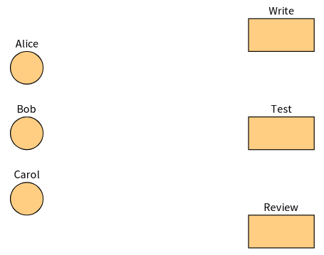

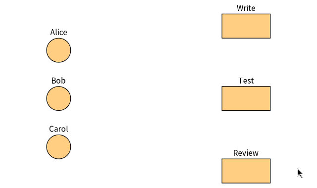

### Shape triggers

A *shape trigger* is a small shape beside the node which runs an action when it is clicked: the node itself can keep its own click for something else. `withTriggerStyle:` gives its style, a block which receives the style sheet of the trigger and the node:

```smalltalk
| visualization |
visualization := TLVisualization fromEntities: (1 to: 5).
visualization styleSheet
	nodeLabel: #asString position: #top;
	width: 40;
	height: 40.
visualization layout: (TLLinearLayout gap: 60).
visualization addInteraction: ((TLCustomAction block: [ :node | node entity crTrace ])
	withTriggerStyle: [ :triggerStyle :node |
		triggerStyle
			shape: TLEllipse;
			width: 14;
			height: 14;
			backgroundColor: (node entity even ifTrue: [ Color red ] ifFalse: [ Color blue ]) ]) onClick.
visualization open.
```

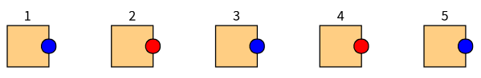

The trigger is a small ellipse by default (`#shapeInteraction` substyle, chapter 4), placed on the side the `triggerPosition` of the style sheet says, `#right` by default. The block is evaluated again when the node is updated, so the trigger can show the state of the node: the default trigger of the composite nodes (chapter 6) writes a + or a - on it.

`withTriggerStyled: firstStyle thatBecome: secondStyle` gives two styles which a reversible action alternates.

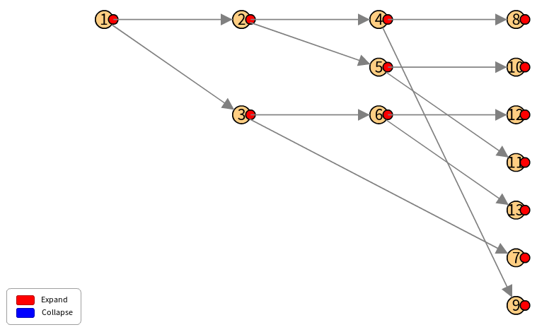

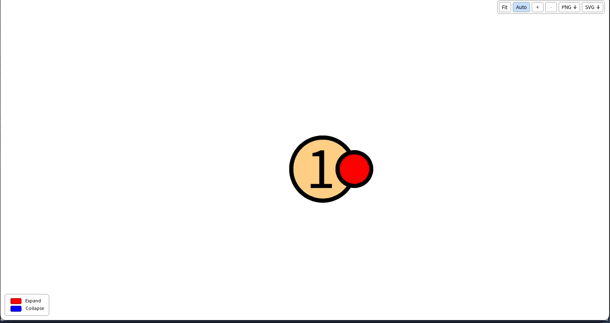

### External triggers

An *external trigger* is an interaction which does not wait for the mouse: something else in your application asks for it, a button for example. The connector gives the way: the Bloc connector has `connector triggerExternal: anInteractionOrItsId`, which runs the action on all the nodes which have the interaction.

```smalltalk
interaction := (TLCustomAction block: [ :node | node entity crTrace ]) onExternalTrigger.
visualization addInteraction: interaction.
visualization open.
"... later, from a button of your application"
visualization generator triggerExternal: interaction.
```

`interaction triggerId` is the id of the interaction, a string which you can also give to `triggerExternal:`.

## What: the actions

An action is a subclass of `TLAction`. The ones of Telescope are:

| Action | What it does |
|---|---|
| `TLCustomAction block: aBlock` | Evaluates the block with the drawable |
| `TLCustomWithParameterAction block: aBlock` | Evaluates a block with the drawable and the parameter of the interaction (a menu choice, a dropped node, a new position) |
| `TLStyleCustomizationAction custom: aBlock` | Changes the style of the drawable with the block. `custom:target:` changes the style of other drawables: the block of the target receives the drawable and answers them. It is reversible |
| `TLConnectAction property: aBlock context: nodes` | Connects the node to the nodes of the entities the block answers. It is reversible |
| `TLConnectWithEntityAction connectionProperty:property:context:` | The same, with connections which are entities |
| `TLExpandCollapseNodesAction property: aBlock` | Adds the nodes of the entities the block answers, connected to the node, and removes them when done again. It is reversible |
| `TLExpandCollapseCompositeNodeAction onCompositeNodeWithChildren` | Expands and collapses a composite node |
| `TLHideAction on: aDrawable` / `TLShowAction on: aDrawable` | Hides (shows) the drawable, or the ones a block answers. They are reversible |
| `TLMoveConnectableAction destination: aGroup` | Moves the node to the group, and back when done again |
| `TLPopUpAction text: aBlock` | Shows a text near the node |
| `TLInspectAction` | Inspects the entity |
| `TLMemorizeNodePositionAction` | Keeps the position the user gave to the node (`onMove`) |
| `action updateAlso: anotherVisualization` | Updates another visualization after the action |

### Connecting nodes

```smalltalk
| visualization |
visualization := TLVisualization fromEntities: (1 to: 14).
visualization nodeLabel: #asString.
visualization layout: (TLCircularLayout gap: 20).
(visualization styleSheet > #connectDemo)
	color: Color orange;
	width: 2.
visualization addInteraction: ((TLConnectAction
	property: [ :number | (1 to: 14) copyWithout: number ]
	context: visualization allNodes)
	connectToOrigin: #even;
	connectionStyle: #connectDemo;
	yourself) onMouseOver.
visualization open.
```

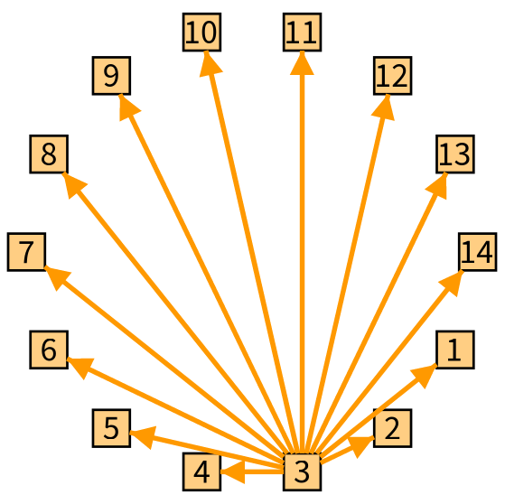

`connectToOrigin:` says whether the connections go to the node which has the interaction (`true`, or a block which receives the node) or come from it. `connectionStyle:` names the style applied to the new connections (the substyle `#connectDemo` above).

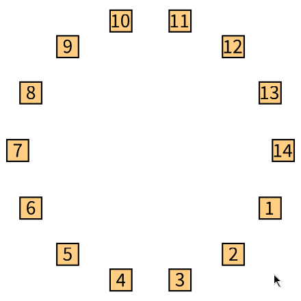

### Expanding nodes

```smalltalk
| visualization |
visualization := TLVisualization fromEntities: (1 to: 3).
visualization nodeLabel: #asString.
visualization layout: (TLTreeLayout new
	useOutgoingLinks;
	leavesGap: 20;
	levelGap: 40;
	yourself).
visualization addInteraction: (TLExpandCollapseNodesAction property: [ :number |
	number < 100
		ifTrue: [ (0 to: 2) collect: [ :index | number * 10 + index ] ]
		ifFalse: [ #() ] ]) onClick.
visualization open.
```

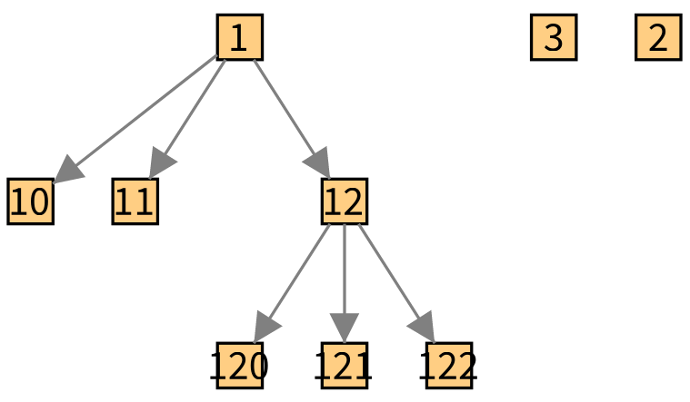

The new nodes are added to the group of the node (`destinationGroup:` chooses another one) and connected to it. The Bloc connector makes them slide from the node.

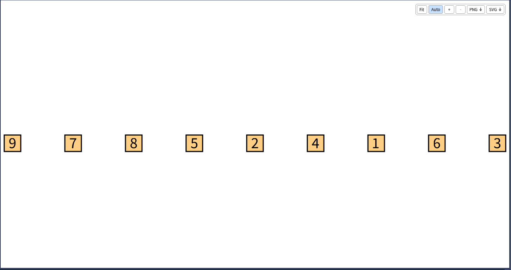

### Hiding and showing

```smalltalk
| visualization firstNode secondNode thirdNode |
visualization := TLVisualization new.
visualization layout gap: 50.
firstNode := visualization addNodeFromEntity: 2.
secondNode := visualization addNodeFromEntity: 1.
secondNode styleSheet nodeLabel: 'Click on me!' position: #top.
thirdNode := visualization addNodeFromEntity: 3.
thirdNode hide.
secondNode addInteractions: {
	(TLHideAction on: firstNode) onClick.
	(TLShowAction on: thirdNode) onClick }.
visualization open.
```

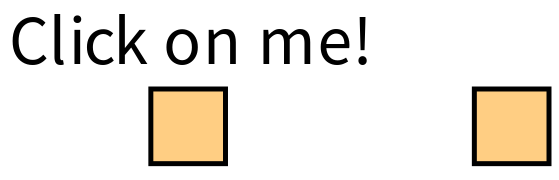

`TLHideAction on:` and `TLShowAction on:` take a drawable, which can be a node or a connection, or a block which answers drawables. A hidden drawable is not displayed, and a connection to a hidden node is not either.

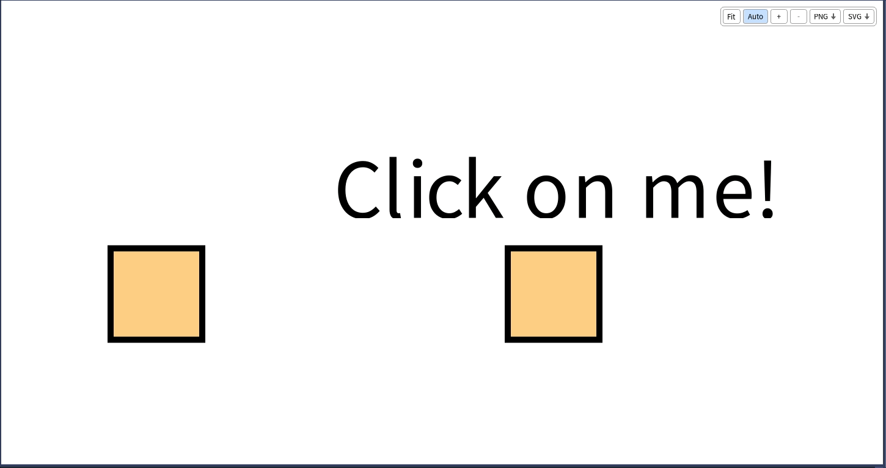

### Moving nodes between groups

```smalltalk
| visualization |
visualization := TLVisualization new.
visualization nodeLabel: #asString.
visualization > #group1
	layout: TLLinearLayout topToBottom;
	addNodesFromEntities: ($a to: $d);
	addInteraction: (TLMoveConnectableAction destination: visualization > #group2) onClick.
visualization > #group2
	layout: TLLinearLayout topToBottom;
	addNodesFromEntities: ($e to: $h);
	addInteraction: (TLMoveConnectableAction destination: visualization > #group1) onClick.
visualization open.
```

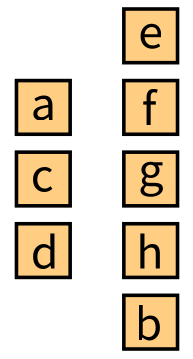

### Two visualizations

`action updateAlso: anotherVisualization` updates it after the action, so that an action on a node of one visualization can change the other one. See `TLDemos exampleTwoConnectedVisualization`.

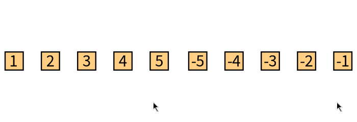

## Writing an action

An action is a subclass of `TLDrawableAction` (or `TLNodeAction` when it only makes sense on a node) which implements `actionOn: aDrawable`:

```smalltalk
TLDrawableAction << #MyAction
	slots: {};
	package: 'MyPackage'.

MyAction >> actionOn: aDrawable
	aDrawable entity crTrace
```

A reversible action is a subclass of `TLReversibleNodeAction`, which implements `regularActionOn:`, `reverseActionOn:` and `shouldTriggerReverseActionFor:`, the last one telling whether the action was already done on the node: that is what makes `onMouseOver` and a second click undo it.

After an action, the connector updates the visualization: the nodes and connections which the action added, removed or restyled are displayed.
