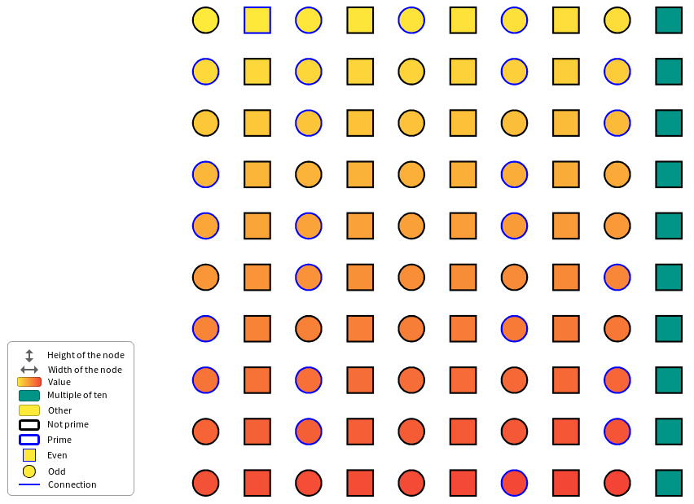
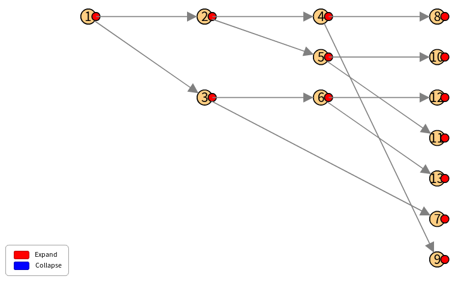
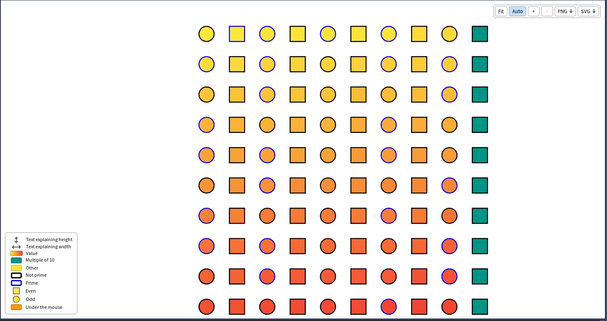

# 8. Legends

When the size, the color or the shape of the nodes depend on their entity, the reader needs to know what they mean. A *legend* is a list of entries, each one describing a property of the style. A visualization has one: `visualization legend`.

```smalltalk
| visualization gradient |
visualization := TLVisualization fromEntities: (1 to: 100).
gradient := (MDLColor yellow property: #yourself gradientAt: 1)
	to: MDLColor red at: 100;
	yourself.
visualization styleSheet
	backgroundColor: [ :number | number \\ 10 = 0 ifTrue: [ MDLColor teal ] ifFalse: [ gradient value: number ] ];
	borderColor: [ :number | number isPrime ifTrue: [ Color blue ] ifFalse: [ Color black ] ];
	shape: [ :number | number even ifTrue: [ TLRectangle ] ifFalse: [ TLEllipse ] ].
visualization legend
	descriptionForHeight: 'Height of the node';
	descriptionForWidth: 'Width of the node';
	description: 'Value' forGradient: gradient;
	backgroundDescription: [ :number | number \\ 10 = 0 ifTrue: [ 'Multiple of ten' ] ifFalse: [ 'Other' ] ] forNodes: [ visualization obtain recursively nodes ];
	borderColorDescription: [ :number | number isPrime ifTrue: [ 'Prime' ] ifFalse: [ 'Not prime' ] ] forNodes: [ visualization obtain recursively nodes ];
	nodeShapeDescription: [ :number | number even ifTrue: [ 'Even' ] ifFalse: [ 'Odd' ] ] forNodes: [ visualization obtain recursively nodes ];
	description: 'Connection' forConnectionStyle: (TLStyleSheet new color: Color blue; yourself) icon: '→'.
visualization open.
```



The connector places the legend: the Bloc connector draws it at the bottom left of the window, and the visualization is fitted in the space which is left.

## Static entries

A static entry describes a property whose meaning you give:

| Message | Describes |
|---|---|
| `legend descriptionForHeight: 'text'` | The height of the nodes |
| `legend descriptionForWidth: 'text'` | Their width |
| `legend description: 'text' forColor: aColor` | A color |
| `legend description: 'text' forGradient: aGradient` | A gradient of colors |
| `legend description: 'text' forBorderColor: aColor` | A color of border |
| `legend description: 'text' forBorderShape: aShape` | A shape of node, drawn as a border |
| `legend description: 'text' forConnectionStyle: aStyleSheet icon: aString` | The style of a connection: its color, with an arrow |

```smalltalk
visualization legend
	description: 'Dead' forColor: Color red;
	description: 'Alive' forColor: Color green.
```

## Dynamic entries

A dynamic entry is *computed* from the nodes: you give a block which describes a node, and a block which answers the nodes, and Telescope makes one line for each description it finds, with the style of the first node which has it. It stays right when the nodes change.

| Message | Describes |
|---|---|
| `legend backgroundDescription: aBlock forNodes: nodesBlock` | The background colors |
| `legend borderColorDescription: aBlock forNodes: nodesBlock` | The border colors |
| `legend nodeShapeDescription: aBlock forNodes: nodesBlock` | The shapes |

In the example above, the first block answers `'Multiple of ten'` or `'Other'` for the entity of a node, and the second one `[ visualization obtain recursively nodes ]` the nodes to describe (chapter 10). The legend is updated with the visualization: when an interaction changes the color of a node, the entries are computed again.

## Where is the legend defined

The legend of a template is defined in its `buildLegend` method (chapter 9), where a visualization of yours can define its own too.




