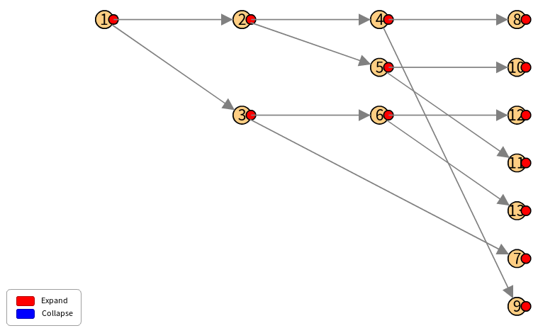
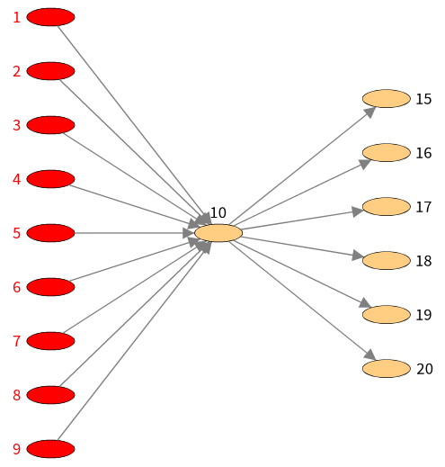
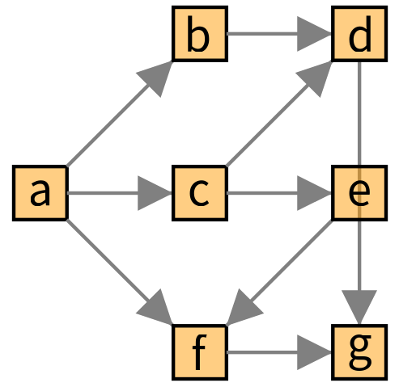
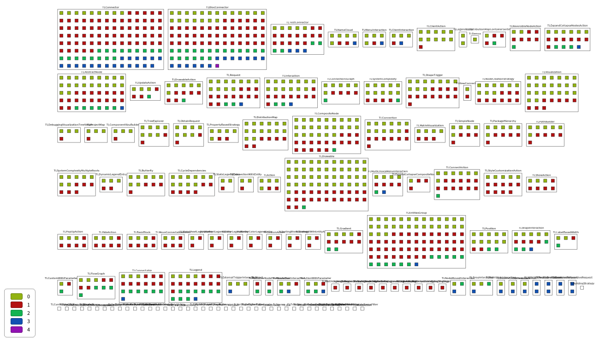
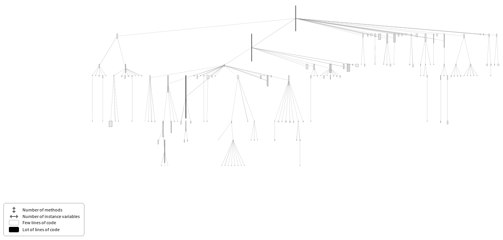
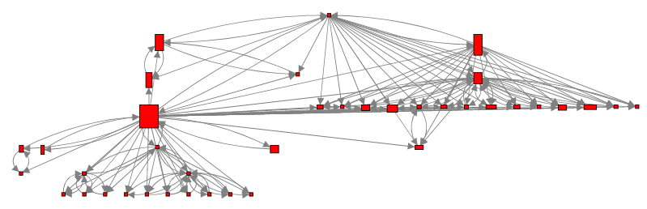
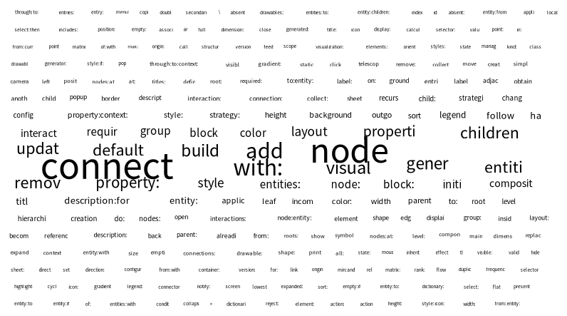
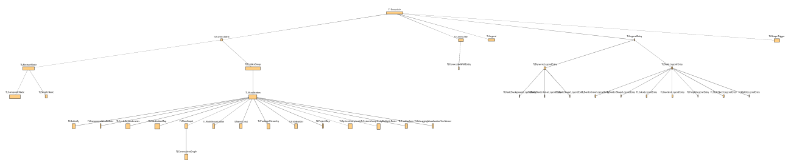
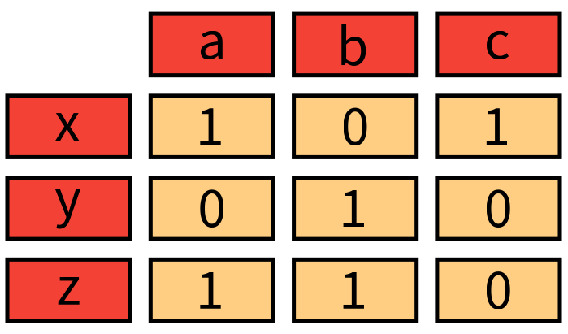
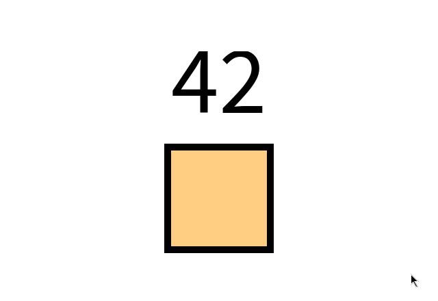

# 9. Visualization templates

A *template* is a subclass of `TLVisualization` which builds a complete visualization from a few parameters. The nodes, layouts, interactions and legend are made when the visualization is opened. The package `Telescope-VisualizationTemplates` has the following ones. Each one has a demo in `TLDemos`.

| Template | Shows |
|---|---|
| [`TLTreeExplorer`](#tree-explorer) | A tree which the user expands with triggers |
| [`TLButterfly`](#butterfly) | A central entity with the entities which lead to it at its left and the ones which follow at its right |
| [`TLFlowGraph`](#flow-graph) | The flow which starts from an entity: each entity at the level of its distance |
| [`TLConnectionsGraph`](#connections-graph) | A variation of the flow graph, which computes the levels itself |
| [`TLDistributionMap`](#distribution-map) | Containers drawn as maps of the colored boxes of their elements |
| [`TLSystemComplexity`](#system-complexity) | An inheritance tree with width, height and color from the entities |
| [`TLSystemComplexityMultipleRoots`](#system-complexity) | The same, for several roots |
| [`TLCycleDependencies`](#cycle-dependencies) | Entities and their dependencies, with the cycles highlighted |
| [`TLNameCloud`](#name-cloud) | The words used by the names of the entities, sized by frequency |
| [`TLPackageHierarchy`](#package-hierarchy) | The hierarchy of packages |
| [`TLMatrixVisualization`](#matrix) | A matrix with titles for its rows and columns |
| [`TLPathBuilder`](#path-builder) | A path which the user builds by following links |
| [`TLProjectMap`](#project-map) | The dependencies of a Metacello project |
| [`TLComponentVizuBuilder`](#components) | Containers with their children inside |

A template is used as any visualization: set its parameters, add interactions or change its style, then `open` it.

## Tree explorer

`TLTreeExplorer root: anEntity expandProperty: aBlockOrSymbol` shows the root, and the user expands each node with its trigger, which shows its children. The legend explains the colors of the triggers.

```smalltalk
| visualization |
visualization := TLTreeExplorer root: 1 expandProperty: [ :number | { number * 2. number * 2 + 1 } ].
visualization open.
```



## Butterfly

`TLButterfly` has a main entity (`mainEntity:`), the entities at its left (`leftEntities:`) and at its right (`rightEntities:`): a block, a symbol or a collection. The nodes at the left and right are in the groups `#left` and `#right`.

```smalltalk
butterfly := TLButterfly new
	mainEntity: 10;
	leftEntities: [ :number | 1 to: number - 1 ];
	rightEntities: (15 to: 20).
butterfly styleSheet
	shape: TLEllipse;
	width: 40;
	borderWidth: 0.5.
(butterfly styleSheet > #redBackground)
	backgroundColor: Color red;
	textColor: Color red.
butterfly > #left addStyle: #redBackground.
butterfly open.
```



## Flow graph

`TLFlowGraph new entryPoint: anEntity; nextProperty: aBlock` shows the entities which can be reached from the entry point, each one in a column which is its distance, and connected to its successors.

```smalltalk
| visualization graph |
graph := { #a -> #(#b #c #f). #b -> #(#d). #c -> #(#d #e). #d -> #(#g). #e -> #(#f). #f -> #(#g) } asDictionary.
visualization := TLFlowGraph new
	entryPoint: #a;
	nextProperty: [ :letter | graph at: letter ifAbsent: [ #() ] ];
	yourself.
visualization styleSheet nodeLabel: #asString.
visualization open.
```



## Connections graph

`TLConnectionsGraph` is a variation of the flow graph: the levels are computed by the visualization, and the connections are shown to the nodes beyond the immediate neighbors. Its parameters are `connectionProperty:`, `edgeDirection:` (`#incoming` or `#outgoing`, the root being at the right or at the left) and `elements:`. Read its class comment.

## Distribution map

`TLDistributionMap containerEntities: containers innerEntities: aBlock property: aBlock` draws one big box for each container, filled with one small box for each of its inner entities, colored by the value of the property. The containers are sorted so that similar ones are close to each other.

```smalltalk
visualization := (TLDistributionMap
	containerEntities: TLObject withAllSubclasses
	innerEntities: #methods
	property: #numArgs)
	innerEntitiesPopupBlock: [ :method | method name , ' have ' , method numArgs asString , ' arguments' ];
	yourself.
visualization open.
```



## System complexity

`TLSystemComplexity` draws a hierarchy, the system complexity view: each node is a class, as high as it has methods, as wide as it has instance variables, and darker when it has more lines of code. Its legend says so.

```smalltalk
visualization := TLSystemComplexity new
	root: Collection;
	property: #subclasses.
visualization addInteraction: TLPopUpAction onMouseOver.
visualization open.
```



`container:` groups the classes by package (`TLDemos exampleSystemComplexityInContainer`), and `TLSystemComplexityMultipleRoots` takes `roots:` and blocks for the width, height and background color (`TLDemos exampleSystemComplexityMultipleRoots`).

## Cycle dependencies

`TLCycleDependencies` takes `entities:`, `property:` (the dependencies of an entity), and `widthBlock:` and `heightBlock:`. The cycles are highlighted.

```smalltalk
TLCycleDependencies new
	entities: TLDrawable withAllSubclasses;
	property: [ :class | (OrderedCollection with: class allSubclasses with: class superclass) flattened ];
	widthBlock: [ :class | class instVarNames size * 3 max: 5 ];
	heightBlock: [ :class | class numberOfMethods / 2 max: 5 ];
	yourself
```



## Name cloud

`TLNameCloud new entities: aCollection; nameProperty: aBlock` shows the words which the names are made of, as large as they are frequent. The camel case is split and the usual words (the stop words) are removed.

```smalltalk
TLNameCloud new
	entities: (TLDrawable withAllSubclasses flatCollect: #methods);
	nameProperty: #selector;
	yourself
```



## Package hierarchy

`TLPackageHierarchy` draws the packages of a hierarchy: `entities:`, `nameProperty:`, `property:` (the parent), `widthProperty:` and `heightProperty:`.



## Matrix

`TLMatrixVisualization newWithMatrix: rows xTitles: titles yTitles: titles` draws a table:

```smalltalk
| visualization |
visualization := TLMatrixVisualization newWithMatrix: #( #( 1 0 1 ) #( 0 1 0 ) #( 1 1 0 ) ) xTitles: #( 'a' 'b' 'c' ) yTitles: #( 'x' 'y' 'z' ).
visualization open.
```



## Path builder

`TLPathBuilder` starts from an `origin:` and two blocks: `incomingBlock:` gives the entities before an entity, `outgoingBlock:` the ones after. The user follows the links from node to node and keeps the nodes which make a path.

```smalltalk
TLPathBuilder new
	origin: 42;
	incomingBlock: [ :aNumber | aNumber to: aNumber + 10 ];
	outgoingBlock: [ :aNumber | aNumber - 11 to: aNumber - 1 ];
	yourself
```



## Project map

`TLProjectMap version: aMetacelloVersion` draws the projects a Metacello version depends on (`TLProjectMap version: BaselineOfIceberg project version`).

## Components

`TLComponentVizuBuilder` shows containers with their children inside, arranged vertically, each one collapsible. Give the containers with `componentsToDisplay:` and set the children of a container as for a composite node (chapter 6).

## Writing a template

A template is a subclass of `TLVisualization` which fills itself in `buildVisualization`. The connector calls it when the visualization is generated:

```smalltalk
TLVisualization << #MyTemplate
	slots: { #entities };
	package: 'MyPackage'.

MyTemplate >> entities: aCollection
	entities := aCollection

MyTemplate >> buildVisualization
	self
		addNodesFromEntities: entities;
		layout: (TLLinearLayout gap: 20 perLine: 5).
	self styleSheet nodeLabel: #asString.
	super buildVisualization

MyTemplate >> defaultTitle
	^ 'My template'
```

`buildVisualization` ends with `super buildVisualization`, which builds the legend (`buildLegend`: override it to describe your colors, chapter 8). `defaultTitle` is the title of the window (Telescope puts its name around it). A template can give its drawables the same properties as any visualization: its `styleSheet`, its groups, its interactions.
