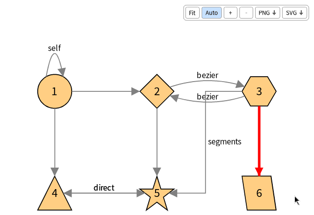
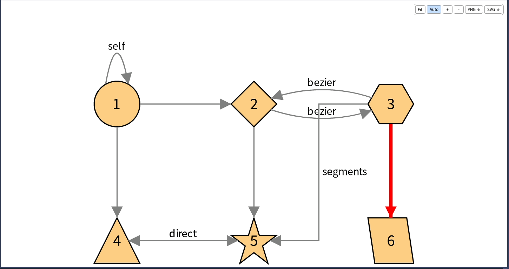

# 11. Connectors

A connector renders a visualization with a graphical framework. Telescope has no dependency on any of them: the visualization is a model, and the connector does the drawing, the events and the animation.

## The connectors

| Connector | Framework | Where |
|---|---|---|
| **TelescopeBloc** (`TLBlocConnector`) | Bloc, in a window of Pharo | [github.com/TelescopeSt/TelescopeBloc](https://github.com/TelescopeSt/TelescopeBloc) |
| **TelescopeCytoscape** | Cytoscape.js, in a web page, with Seaside | [github.com/TelescopeSt/TelescopeCytoscape](https://github.com/TelescopeSt/TelescopeCytoscape) |
| A Roassal connector | Roassal | Not maintained: the last version is the commit `9fafc43` |
| `TLTestConnector` | Nothing: it records what it is asked to do | In the tests of Telescope |

The connector which `visualization open` uses is the one `TLCurrentConnector value` answers: the loaded connector with the highest `priority` (a class-side method of the connector). `TLCurrentConnector value: aConnectorClass during: aBlock` uses another one for the block, and `visualization generator: aConnector` fixes it for one visualization.

## What the connectors support

A connector does not have to support every feature: the ones it does not raise `TLNotSupportedFunctionalityException`. The Bloc connector supports:

- all the nodes, shapes, colors, borders, labels, sizes and styles, and the legends;
- all the connections, curve styles and line styles, the heads, the arrows and the labels;
- the groups, the composite nodes, all the layouts and the sorting strategies;
- all the interactions, except the client side ones: mouse over, click, double click, right click, menus, pop ups, drop, move, shape triggers and external triggers (`connector triggerExternal:`);
- zooming with the wheel, panning with the background, dragging the nodes, a toolbar (fit, zoom, auto fit, export as PNG or SVG), animations of the layouts, and a demo browser;
- not `showChildrenConnectionsOnParent`, which Telescope itself does not implement.

The Cytoscape connector runs in a browser: its interactions can be client side (`TLClientAction`, which has a script written in JavaScript).

## Writing a connector

A connector is a subclass of `TLConnector` (or `TLViewConnector`, which has a view). It answers the questions of the visualization in `generate...`, `update...` and `remove...` methods. The Bloc connector is the most complete example and `TLTestConnector` the smallest one.

| Responsibility | Messages to implement |
|---|---|
| Opening | `open:inWindowSized:titled:`, `closeVisualization`, `class>>priority`, `isRealConnector` |
| Nodes | `createElementNodeFromNode:`, `addElementNodeInView:`, `updateElementNodeOf:`, `removeElementFromView:associatedToDrawable:`, `define:asParentFor:` (children of a composite node) |
| Groups and layouts | `createGroup:with:`, `displayGroupElement:`, `applyLayoutOf:on:` |
| Connections | `createElementConnection:From:to:`, `addElementConnectionInView:`, `removeElementConnectionFromView:`, `connectionHeadShapesAvailableForConnector` |
| Shapes | `nodesShapesAvailableForConnector` |
| Interactions | one `generate...Interaction:onDrawable:targetingDrawable:` for each kind: click, double click, right click, mouse over, drop, moved, menus, pop up, external trigger |
| Shape triggers | `createElementFromTrigger:`, `placeElement:correspondingToTrigger:relativeToDrawable:`, `updateShapeTrigger:` |
| Legends | `createLegendFrom:`, `addElementLegendInView:`, `generateTLColorLegendEntry:` and the other entries |
| Update | `updateViewForVisualization:`, `notify:forVisualization:` |

The generic part is in `TLConnector`: it generates each drawable of the visualization in the right order (nodes, then connections, then interactions), keeps the elements it creates (`registerShape:forDrawable:`, `elementFromTLDrawable:`) and finds the right drawable from an element (`tlDrawableFromElement:`). It executes the actions with `executeInteraction:forDrawable:`, and its variants for the reversible actions, the parameters and the choices of menus.

Two rules help a connector stay independent from its framework:

- **The model asks, the connector answers.** A layout reads the dimension and writes the position of the nodes through the connector's elements: they must answer `dimension`, `position:` and `occupyMaxSpace` as Telescope's nodes do. If a framework element does not, add the message to the element, and do not change Telescope.
- **Do not duplicate Telescope.** The style is evaluated by Telescope: ask `effectiveStyleSheet obtainValue: #property forEntity: entity inNode: node`, and draw the answer.
