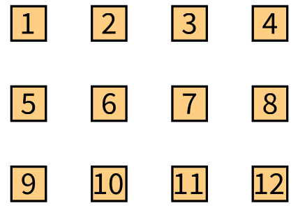

# Telescope documentation

Telescope is an engine to build visualizations. You describe *what* to show: the entities of your model, how they are connected, how they look, where they are placed and how the user interacts with them. A *connector* renders the description with a graphical framework. This documentation describes the API of Telescope: it is the same whatever the connector.

```smalltalk
| visualization |
visualization := TLVisualization new.
visualization addNodesFromEntities: (1 to: 12).
visualization nodeLabel: #asString.
visualization layout: (TLLinearLayout gap: 20 perLine: 4).
visualization open.
```



The screenshots of this documentation were made with the [Bloc connector](https://github.com/TelescopeSt/TelescopeBloc). The animated parts are GIFs, which are listed in [gifs/README.md](gifs/README.md).

## Chapters

| Chapter | What you will find |
|---|---|
| [1. Getting started](01-Getting-Started.md) | The model of Telescope, a first visualization, how to open it and the demos |
| [2. Nodes and entities](02-Nodes-and-Entities.md) | Creating, finding and changing nodes, and the API of a node |
| [3. Groups and layouts](03-Groups-and-Layouts.md) | Grouping nodes, placing them with the linear, circular and tree layouts, sorting them |
| [4. Styling](04-Styling.md) | The style sheets, and every property of a node: shape, colors, borders, sizes, labels |
| [5. Connections](05-Connections.md) | Connecting nodes, the style of the lines, the heads, the arrows and the labels |
| [6. Composite nodes](06-Composite-Nodes.md) | Nodes which contain other nodes, and how to expand and collapse them |
| [7. Interactions](07-Interactions.md) | Mouse over, click, menus, pop ups, drag and drop, shape triggers, external triggers and all the actions |
| [8. Legends](08-Legends.md) | Describing what the sizes, colors and shapes mean |
| [9. Visualization templates](09-Visualization-Templates.md) | The ready-made visualizations: tree explorer, butterfly, flow graph, distribution map... |
| [10. Querying and updating](10-Querying-and-Updating.md) | The requests on the model, the update cycle, the state of a drawable |
| [11. Connectors](11-Connectors.md) | Choosing a connector, what the Bloc connector offers, writing a connector |

## The vocabulary

| Word | Meaning |
|---|---|
| **Entity** | An object of your model. Telescope displays your objects, whatever they are |
| **Drawable** | Anything Telescope draws and which can have interactions and a style: a node, a group, a connection, a legend |
| **Node** | A drawable for one entity. A *simple node* is a leaf, a *composite node* contains other nodes |
| **Group** | A set of drawables placed by a layout. A visualization is a group |
| **Connection** | A link between two nodes |
| **Layout** | The algorithm which places the nodes of a group |
| **Style sheet** | The properties which say how a drawable looks. A drawable inherits the style of its parents |
| **Interaction** | When and how the user acts: a click, a mouse over, a menu... It runs an **action** |
| **Action** | What happens: connect nodes, expand a node, hide something, run a block... |
| **Legend** | The description of the styles which depend on the entities |
| **Connector** | The object which renders a visualization in a graphical framework |

## Conventions of the examples

Each example creates a `visualization`, and ends by opening it. The visualization is displayed by the connector which is loaded in your image. The examples use the demo dependencies of Telescope (`MDLColor`, the Material Design colors) in a few places.
